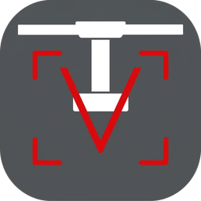

# CraneStrike — ciclogrammi carroponti (Cyclic Hoist Scheduling) con OR-Tools CP-SAT



**CraneStrike** e' uno strumento per calcolare il ciclogramma periodico di uno o piu' carroponti
che spostano pezzi attraverso una sequenza di vasche, rispettando:

- tempi di permanenza min/max per vasca (tolleranza di processo),
- un takt time target con tolleranza,
- velocita', accelerazione e decelerazione massime diverse per carroponte
  vuoto e carico, con una zona di avvicinamento a velocita' ridotta vicino al
  punto di presa e deposito,
- vincoli di non collisione fra carroponti sulla stessa rotaia.

Si usa da **interfaccia grafica**, da riga di comando o come libreria Python.
La linea si descrive in un file Excel e i risultati escono in Excel. Ogni
soluzione, calcolata o disegnata a mano, passa da un **verificatore
indipendente** che la ricontrolla senza usare il solutore.

## Perche' CP-SAT

Il problema è un **Cyclic Hoist Scheduling Problem (CHSP)**: un problema di
scheduling ciclico, NP-hard, con vincoli fortemente disgiuntivi (due
carroponti non possono occupare lo stesso punto di rotaia nello stesso
istante). La Constraint Programming — e nello specifico CP-SAT di OR-Tools —
è lo strumento standard in letteratura per questo tipo di problema, proprio
per la sua naturalezza nel esprimere vincoli disgiuntivi/di non-overlap e
periodici. È una scelta valida: il codice qui sotto la usa.

## I file del progetto

In radice ci sta **solo il programma**: i nove moduli che lo compongono, i due
documenti e il file da doppio clic. Tutto il resto e' in una sottocartella.

```text
create_cyclograms/
  interfaccia.py  simulazione.py  ciclogramma.py       <- i moduli: nessuna
  model.py  verify.py  excel_io.py                        sottocartella, cosi'
  kinematics.py  plotting.py  manuale.py                  si importano per nome
  CraneStrike.bat  README.md  ARCHITETTURA.md
  requirements.txt

  test/        i test e l'esempio d'uso in codice
  strumenti/   costruisci_exe.py, la ricetta PyInstaller e genera_icona.py
  risorse/     icona.ico e icona.png, ricavate da doc/icon.png
  doc/         immagini del manuale, SOLVE_riga_per_riga.docx
  dati/        file Excel di esempio e di prova
```

I moduli restano tutti in radice di proposito. Sono nove, quindi non e' un
disordine: metterli in un package obbligherebbe a scrivere
`from ciclogrammi.model import ...` ovunque e ad avviare con `python -m`,
mentre questo programma non si installa mai con `pip` — gira dalla cartella o
dall'eseguibile.

Le dipendenze vanno in una direzione sola — interfaccia -> motore ->
cinematica — e mai al contrario: `model.py` non sa che esiste un'interfaccia, e
`kinematics.py` non sa che esiste un ciclogramma. E' quello che permette di
provare il motore senza aprire una finestra, e la cinematica senza avere
OR-Tools installato.

```text
  interfaccia.py      ciclogramma.py   test/esempio.py      <- si lanciano
        |                   |                  |
        +-------------------+------------------+
        |          |          |         |          |
  excel_io.py manuale.py plotting.py verify.py simulazione.py   <- contorno
        |          |          |         |          |
        +----------+----+-----+---------+----------+
                        |
                    model.py                                <- motore (CP-SAT)
                        |
                  kinematics.py                             <- fisica
```

### Motore di calcolo

| file | righe | contenuto |
| --- | ---: | --- |
| `kinematics.py` | 413 | La fisica del movimento, in millimetri e secondi. Accelerazione e decelerazione sono due numeri distinti, e il sollevamento puo' avere una zona di avvicinamento a velocita' ridotta. `travel_time()` da' il tempo per percorrere una distanza con profilo trapezoidale o triangolare; `position_profile()` la posizione istante per istante; `profile_breakpoints()` gli spigoli della curva, che servono al verificatore per limitare in modo rigoroso l'errore di campionamento. Non sa nulla del resto del progetto. |
| `model.py` | 2052 | Il cuore. Contiene le **strutture dati** (`Tank`, `StationSpec`, `HoistZone`, `ProblemData`, `Segment`, `Solution`), la costruzione e risoluzione del **modello CP-SAT** (`solve`), la scelta automatica di zone e numero di carroponti (`solve_auto_zones`, `solve_auto_hoists`), e la costruzione di un ciclogramma **senza risolvere** a partire dai suoi gradi di liberta' (`build_solution`, `estrai_gradi_di_liberta`) — quest'ultima e' cio' che rende possibile l'editor. |
| `verify.py` | 1043 | Il **verificatore indipendente**: `verify_solution()` ricontrolla una soluzione in Python puro, senza CP-SAT, campionando le posizioni reali dei carroponti. Restituisce un `VerificationReport` con l'elenco delle `Violation` divise per gravita'. E' la rete di sicurezza contro gli errori nella formulazione del modello. |
| `manuale.py` | 260 | Il ciclogramma nei termini in cui si modifica: il "pettine" dei pezzi (`pettine`, `catena_pezzo`), la composizione libera del ciclogramma (`componi`) e il controllo che i carroponti non si scavalchino sulla rotaia (`perche_non_va`). |

### Ingresso, uscita, disegno

| file | righe | contenuto |
| --- | ---: | --- |
| `excel_io.py` | 1742 | Tutto l'Excel: `scrivi_modello()` genera il file da compilare, `leggi_problema()` lo rilegge raccogliendo **tutti** gli errori di compilazione con foglio e cella, `scrivi_risultati()` produce il file dei risultati -- che e' anche un file di ingresso, col ciclogramma dentro, per poterlo riaprire, diviso in due meta' (`Input` e `Output`) dietro due cartelli colorati. |
| `plotting.py` | 470 | `plot_cyclogram()`: disegna il ciclogramma (posizione lungo la rotaia contro tempo) con il profilo cinematico vero, non con segmenti diritti, i punti sugli istanti in cui succede qualcosa (aggancio, sgancio, partenza, arrivo), le frecce su e giu' sulle corse verticali del gancio e il pezzo fermo in vasca come linea grigia. |
| `simulazione.py` | 1388 | La **simulazione**: la linea vista di fronte, in movimento. `Simulazione` e' la parte che conta e non importa tkinter — dato un istante dice dove sta ogni carroponte (posizione, quota del gancio, cosa sta facendo) e ogni pezzo; `FinestraSimulazione` e' solo la finestra che la anima. Non calcola niente di nuovo: legge `segments_per_hoist` e `actual_time` della soluzione, cioe' gli stessi oggetti che disegnano il ciclogramma. |

### Programmi da lanciare

| file | righe | contenuto |
| --- | ---: | --- |
| `interfaccia.py` | 2053 | L'**interfaccia grafica** (tkinter). La classe `Applicazione` e' tutta la finestra: caricamento, calcolo in background, grafico incorporato (ciclogramma o pettine, secondo come ci si e' arrivati), la pagina unica in cui il ciclogramma si modifica -- calcolato o composto da zero che sia -- simulazione, verifica e salvataggio. `autotest()` prova l'installazione da sola. E' il programma che usa un utente normale. |
| `ciclogramma.py` | 191 | Lo stesso lavoro da **riga di comando**, per chi preferisce il terminale o vuole automatizzare. |
| `test/esempio.py` | 198 | La linea di esempio definita **in codice** invece che in Excel, per chi vuole integrare il solutore in qualcos'altro. |
| `strumenti/costruisci_exe.py` | 119 | Costruisce l'**eseguibile autonomo** con PyInstaller. Vedi sotto. |
| `strumenti/cranestrike.spec` | — | La ricetta per PyInstaller: cosa includere, cosa escludere, come impacchettare. Non si lancia a mano, la usa `costruisci_exe.py`. |
| `strumenti/genera_icona.py` | 164 | Ricava `risorse/icona.ico` e `risorse/icona.png` da `doc/icon.png`, rendendo trasparente il bianco fuori dal quadrato arrotondato. Le misure piccole (16–48 px) le ridisegna invece di rimpicciolirle, perché restino nitide. Si rilancia solo se l'immagine cambia; richiede Pillow, il programma no. |
| `strumenti/genera_doc.py` | 470 | Produce i documenti Word in `doc/`: la spiegazione riga per riga di ogni modulo e l'albero delle chiamate. Il codice citato **non e' ricopiato**, viene estratto dal sorgente per nome a ogni generazione. Vedi *La documentazione in `doc/`*. |
| `CraneStrike.bat` | — | Avvia l'interfaccia con un doppio clic, senza aprire il terminale. |

### Test

Ogni file di test si lancia da solo dalla radice del progetto
(`python test/test_xxx.py`), stampa cosa ha provato e restituisce un codice
d'uscita diverso da zero se qualcosa non va. Non serve pytest. Le prime righe
di ogni test aggiungono la cartella sopra ai percorsi di ricerca, cosi' i
moduli si trovano comunque.

| file | righe | cosa verifica |
| --- | ---: | --- |
| `test/test_verify.py` | 999 | **Il verificatore.** Risponde a "chi verifica il verificatore?": venti casi, di cui uno solo corretto e tutti gli altri rotti di proposito (collisioni, permanenze fuori tolleranza, periodicita' incoerente, geometrie patologiche, capienze). Un controllore che non segnala mai nulla e' inutile, quindi ogni controllo ha un caso che DEVE farlo scattare. Non richiede OR-Tools: le soluzioni sono costruite a mano. |
| `test/test_model.py` | 586 | **Il modello CP-SAT.** Risolve davvero e passa ogni soluzione al verificatore: vasche ravvicinate, tre carroponti, capienza, tempi verticali, e la fedelta' della ricostruzione di una soluzione dai suoi gradi di liberta'. Richiede OR-Tools. |
| `test/test_excel_io.py` | 954 | **La lettura e la scrittura Excel.** Quasi tutti i casi sono file compilati male: valori mancanti o non numerici, vasche inesistenti o duplicate, righe riordinate, parametri sbagliati, o un file scritto per la vecchia versione in metri. Piu' l'andata e ritorno del ciclogramma salvato nel file, e la struttura del file dei risultati: l'ordine dei fogli, i due cartelli colorati, e che l'elenco dentro un cartello dica davvero i fogli che seguono. Non richiede OR-Tools. |
| `test/test_simulazione.py` | 755 | **La simulazione.** Il controllo che conta e' incrociato: ogni pezzo appeso deve stare *esattamente* dove sta il gancio di un carroponte che lo tiene, e ogni carroponte che tiene qualcosa deve avere un pezzo li'. Se simulazione e ciclogramma raccontassero due storie diverse, una delle due sarebbe sbagliata. Lo stesso controllo viene rifatto sulle quote **disegnate**, che non sono quelle vere: il telaio deve restare appeso al bilancino anche dopo il rimappaggio delle profondita'. Le vasche di prova hanno corse verticali **diverse fra loro** apposta: con corse tutte uguali, prendere la corsa della vasca sbagliata darebbe comunque il risultato giusto. In fondo, i casi in cui la geometria del disegno degenera: corse e ingombri tutti a zero, tutte le tappe nella stessa vasca. Non richiede OR-Tools. |
| `test/test_interfaccia.py` | 1085 | **Le funzioni dell'interfaccia grafica.** La finestra viene costruita davvero e pilotata da codice — si "premono" i pulsanti chiamando i metodi e si fa girare il ciclo degli eventi con `update()` invece di `mainloop()`. Verifica che i pulsanti si abilitino al momento giusto, che il calcolo in background consegni il risultato, che una soluzione calcolata riletta come tempi in vasca e ricomposta dia esattamente lo stesso ciclogramma, che le modifiche vengano riverificate, che l'immagine salvata sia il ciclogramma anche componendo dal pettine, che la scheda di modifica si apra solo dopo 'Calcola man' o 'Modifica' e mai mentre il solutore lavora, che un ciclogramma salvato si riapra identico anche se lasciato a meta', che la composizione da zero produca il pettine giusto, che un trasporto assegnato si possa togliere con lo stesso gesto con cui lo si e' assegnato, e che la simulazione si apra solo quando un ciclogramma c'e' davvero e segua le modifiche mentre e' aperta. Richiede OR-Tools e un ambiente grafico. |

`kinematics.py` ha in fondo un autotest che si lancia allo stesso modo
(`python kinematics.py`).

## Installazione ed esecuzione

```bash
pip install -r requirements.txt
```

Servono `ortools` (il solutore), `matplotlib` (il disegno) e `openpyxl` (i file
Excel). `pyinstaller` serve solo a chi deve costruire l'eseguibile.

## Come si usa l'interfaccia

Doppio clic su **`CraneStrike.bat`** (oppure `python interfaccia.py`, oppure
`CraneStrike.exe` se si usa la versione impacchettata).


La finestra e' divisa in tre: la **barra dei comandi** in alto, il
**ciclogramma** a sinistra, e a destra un **verdetto** sempre in vista con
sotto tre schede. In basso una barra di stato che dice cosa sta facendo il
programma.

### Il giro completo, in breve

1. `Nuovo modello Excel...` — se non hai ancora un file, questo te lo crea gia'
   compilato con una linea di esempio.
2. Compili il file (vedi *Come modellare il tuo caso*, piu' sotto).
3. `Apri linea...` — lo carichi.
4. `Calcola auto` oppure `Calcola man`.
5. Guardi il verdetto, eventualmente ritocchi.
6. `Salva risultati...` — esce l'Excel dei risultati e l'immagine.

### La barra dei comandi

| pulsante | cosa fa |
| --- | --- |
| `Apri linea...` | Carica un file Excel con la definizione della linea. Se il file e' compilato male non succede nulla di brutto: compare una finestra con **tutti** gli errori trovati, con foglio e cella. |
| `Nuovo modello Excel...` | Crea il file da compilare, gia' pieno con una linea di zincatura d'esempio, e chiede se aprirlo subito. E' il modo consigliato di cominciare: si parte da qualcosa che funziona e lo si modifica. |
| `Calcola auto` | Cerca il numero minimo di carroponti, la suddivisione migliore della linea e il takt time piu' basso. Puo' durare da qualche secondo a qualche minuto: i pulsanti si spengono e la scheda *Ciclogramma* si chiude finche' non ha finito, ma la finestra **non si blocca**. In basso a destra la barra dice a che punto e' e cosa ha gia' in mano: `2 carroponti: tentativo 3 di 5 - ancora circa 3 s - 2 soluzioni trovate, migliore T = 122.14 s: fermando ora resta quella` (vedi *Quanto durera' il calcolo*). |
| `Ferma` | Interrompe `Calcola auto` (e `Ottimizza con questi carroponti`). E' acceso solo mentre il calcolo gira, e il calcolo si ferma entro mezzo secondo. Se fino a quel momento era gia' stata trovata una soluzione valida la mostra e la verifica, dicendo nel Riepilogo che **non e' dimostrata ottima**: e' la migliore fra le suddivisioni provate, e le altre non lo sono state. Se non era stato trovato niente, il ciclogramma che avevi a schermo **resta com'era**, e la barra in basso scrive `Calcolo interrotto`. Uno stop non e' mai un «nessuna soluzione»: la linea non e' stata dimostrata impossibile. |
| `Calcola man` | Butta via il ciclogramma corrente e riparte dai tempi teorici di processo, con **nessun trasporto assegnato**, per comporlo a mano (vedi sotto). |
| `Modifica` / `Fine modifica` | Apre alla modifica il ciclogramma che c'e', portando sul **pettine** — che e' il foglio su cui si assegna. Non cambia niente, ma e' il passaggio obbligato: senza, la scheda *Ciclogramma* resta chiusa. Premuto di nuovo chiude la modifica e riporta a guardare il ciclogramma. |
| `Simulazione` | Apre una finestra a parte in cui la linea si vede **di fronte e in movimento**: i carroponti che scorrono, calano il gancio, tirano su il telaio, lo portano e lo immergono. Si accende solo quando un ciclogramma c'e' — calcolato o composto a mano, e' lo stesso oggetto. Vedi sotto. |
| `Salva risultati...` | Scrive l'Excel dei risultati e, accanto, l'immagine del ciclogramma. **Lo stesso Excel si riapre con `Apri linea...`** per riprendere il lavoro: contiene anche la linea e il ciclogramma. Si abilita solo quando c'e' qualcosa da salvare. |

A destra nella stessa barra c'e' il **percorso completo** del file caricato —
non solo il nome, perche' dello stesso file girano di solito piu' copie (la
scrivania, la cartella di commessa, la rete) e serve sapere quale si sta
guardando. Lo stesso percorso compare nel titolo della finestra e in cima alla
scheda *Riepilogo*: se la barra e' troppo stretta per contenerlo, si legge li'.

### Quanto durera' il calcolo

Durante `Calcola auto` la barra in basso a destra si riempie e accanto si
legge, per esempio:

```text
2 carroponti: tentativo 3 di 5 - ancora circa 3,1 s - 2 soluzioni trovate, migliore T = 122.14 s: fermando ora resta quella
```

Il numero di **tentativi** e' esatto: il programma prova una suddivisione della
linea per volta, e quante siano lo sa in anticipo — e' combinatoria, piu' due
scarti rapidi che tolgono di mezzo le suddivisioni palesemente inutili (su una
linea di dieci vasche, 176 diventano 10).

Il **tempo** invece e' una stima, misurata sui tentativi gia' fatti. Balla,
perche' un tentativo che non trova niente e' molto piu' rapido di uno che trova
una soluzione e deve dimostrarla ottima: prendila come "aspetto o mi alzo?",
non come un cronometro.

Due cose che vale la pena sapere:

- la stima riguarda **quel** numero di carroponti. Se nessuna suddivisione
  funziona, il programma ricomincia con un carroponte in piu' e il conteggio
  riparte da capo: e' normale, e si vede perche' il testo dice sempre con
  quanti carroponti sta provando.
- **prima** di cominciare non viene detto niente, ed e' voluto: l'unico numero
  onesto sarebbe il caso peggiore, e sulla linea d'esempio sarebbe sei minuti e
  mezzo contro sei secondi e mezzo reali.

Le **soluzioni gia' trovate** rispondono all'altra domanda, quella che il tempo
residuo non tocca: *se premo `Ferma` adesso, cosa mi resta?* Con `Ferma` si
tiene la migliore soluzione trovata fino a quel punto — valida, ma scelta fra
quelle provate, quindi non dimostrata ottima. Finche' il conteggio e' a zero,
pero', fermarsi vuol dire restare a mani vuote, e conviene aspettare almeno la
prima. Per questo il numero si legge sempre, anche quando e' zero.

Accanto c'e' il **takt time della migliore**, che e' poi il numero per cui si
sta facendo tutto questo, e puo' solo migliorare mentre la ricerca va avanti:
sulla linea d'esempio scende 139,29 → 122,14 → 110,00 s. Il conteggio dice se
fermarsi e' sicuro, il takt time se conviene. Chi ha in mente il valore che gli
serve riconosce da solo quando puo' smettere.

Il conteggio riguarda il numero di carroponti in corso, come la stima del
tempo, e non si perde niente per strada: la ricerca si ferma al primo numero di
carroponti che funziona, quindi se sta provando con tre vuol dire che con due
non aveva trovato nulla.

Se hai dichiarato tu le zone nel foglio *Zone*, non c'e' niente da provare: il
calcolo e' uno solo e la barra si limita a oscillare.

### Dove il carroponte aspetta

Fra una mossa e l'altra al carroponte avanza quasi sempre del tempo. La
traslazione la fa **sempre a velocita' piena** — quel tempo lo passa fermo — ma
*dove* lo passa non e' indifferente.

Componendo a mano, il programma lo fa aspettare **all'estremo che non e' una
vasca di confine**:

- deve andare su una vasca condivisa col vicino? Aspetta dove ha appena
  consegnato e parte all'ultimo momento utile.
- ha appena consegnato *su* una vasca condivisa? Riparte subito, senza
  sostarci.

Le vasche di confine sono quelle dove uno consegna e l'altro viene a prendere:
restarci fermi per un minuto quando si potrebbe stare altrove e' il modo piu'
facile di fabbricare una collisione che non c'era bisogno di avere.

Il calcolo automatico invece tiene la convenzione opposta — parte appena
consegnato — e non e' una svista: il vincolo di non collisione del solutore e'
costruito su quella, e protegge quella traiettoria. Disegnarne un'altra
vorrebbe dire garantire una cosa e mostrarne un'altra.

### Se non trova niente

Il *Riepilogo* non dice piu' soltanto "nessuna soluzione": dice **cosa e' stato
provato** e, quando riesce a stabilirlo, **perche' non riesce**.

```text
COSA E' STATO PROVATO
  3 carroponti: 36 suddivisioni risolte (22 infeasible, 14 unknown), 84 scartate
  4 carroponti: 336 suddivisioni risolte (191 infeasible, 145 unknown), 224 scartate
  5 carroponti: NON PROVATO - restano 1470 suddivisioni da provare e il limite e' 500

ATTENZIONE: 159 tentativi sono scaduti senza rispondere (UNKNOWN).
Non sono stati dimostrati impossibili: allunga tempo_limite_per_tentativo_s.

PERCHE' NON RIESCE
  IL TAKT TIME E' TROPPO STRETTO: con un ciclo di 690 s queste zone funzionano,
  mentre il massimo dichiarato e' 460 s. Il minimo che basta sta fra 632 e 690 s.
```

Tre cose vanno lette con attenzione.

**`INFEASIBLE` e `UNKNOWN` vogliono azioni opposte.** Il primo e' una
*dimostrazione*: con quelle zone non si puo' fare, e va cambiata la linea. Il
secondo vuol dire soltanto che il tempo e' scaduto: fra quei tentativi
potrebbe esserci la soluzione, e basta alzare `tempo_limite_per_tentativo_s`.

**`NON PROVATO` non vuol dire impossibile.** Se le suddivisioni da esaminare
superano il limite interno, quel numero di carroponti viene saltato. Prima non
si vedeva, e una linea risolvibile poteva sembrare impossibile solo perche'
nessuno ci aveva provato.

**Il *perche'* si ottiene rilassando un vincolo per volta** e guardando quale
rilassamento fa passare la linea: il takt time, le collisioni fra carroponti, i
tempi massimi di processo, la capienza delle vasche. Quando la causa e' una
grandezza, viene cercato anche *di quanto* — fino a nominare la singola vasca:
«basta portare il massimo di ED da 190 a 212 s». Se nessun rilassamento singolo
basta, lo dice: significa che a bloccare sono piu' vincoli insieme, e la strada
e' un carroponte in piu'.

### Come si legge il ciclogramma

Il grafico ha **due disegni**, e non c'e' niente da scegliere: lo decide il
modo in cui sei arrivato.

| disegno | quando compare | cosa mostra |
| --- | --- | --- |
| **ciclogramma** | dopo `Calcola auto`, dopo `Ottimizza con questi carroponti` e dopo `Fine modifica` | le traiettorie dei **carroponti**, su due cicli: chi si muove quando, chi rischia di incontrare chi |
| **modifica** | dopo `Calcola man` e dopo `Modifica` | lo stesso ciclogramma, col **percorso dei pezzi** in grigio sotto: e' il foglio su cui si compone, e ci si clicca sopra per assegnare |

Vale anche tornando indietro: se stavi componendo a mano e premi `Calcola
auto`, il disegno torna al ciclogramma. Il pettine e' il foglio su cui si
**compone**, e un risultato del solutore non si compone: si legge.

**Si modifica sempre sulla pagina di modifica**, anche un ciclogramma appena
calcolato. Non e' una preferenza: nel ciclogramma da solo si disegnano le sole
traiettorie dei carroponti, quindi un trasporto che non e' ancora di nessuno —
o che hai appena tolto a qualcuno — li' **non compare affatto**, pur restando
cliccabile. Non lo vedi e ci inciampi, che e' la combinazione peggiore.

La pagina di modifica mostra le due cose insieme, e in quest'ordine: il
**percorso dei pezzi in grigio**, che e' il foglio su cui si clicca e c'e'
sempre tutto, e sopra il **giro dei carroponti**, disegnato come nell'altra
vista — colore del carroponte, linea spessa, punti sugli eventi. Assegnando una
mossa si vede comparire il pezzo di giro che la esegue, che e' esattamente cio'
che stai decidendo. Prima era il contrario, col flusso dei pezzi colorato e in
evidenza: si vedeva bene dove andavano i pezzi e male cosa dovevano fare i
carroponti, che e' la cosa che si sta componendo.

Un interruttore fra i due c'e' stato ed e' stato tolto: le tabelle della scheda
*Ciclogramma* permettono di modificare tutto — tempi in vasca, assegnazione,
takt time, carroponti — senza cambiare disegno, quindi restava un comando che
chiedeva una decisione senza darne il motivo.

Quello che il disegno a schermo **non** decide e' l'immagine consegnata:
`Salva risultati...` esporta sempre il **ciclogramma**, anche se l'hai composto
guardando il pettine. E' il documento che esce, e non puo' dipendere da cosa
stavi guardando quando hai premuto Salva.

Nel **ciclogramma**: in orizzontale il tempo, in verticale la posizione lungo la
rotaia: le vasche sono le righe, col nome e la quota sull'asse. Il disegno
ripete **due cicli** di seguito, cosi' si vede a occhio che il pattern si
richiude.

Sulle traiettorie ci sono dei **pallini**: segnano gli istanti in cui succede
qualcosa, cioe' l'**aggancio** e lo **sgancio** del telaio e la **partenza** e
l'**arrivo** di ogni traslazione. Sono tutti uguali e non hanno una voce in
legenda, perche' cosa sia ciascuno lo dice gia' la traiettoria: se li' la linea
diventa obliqua il carroponte parte, se resta piatta il telaio cambia mano.

Sopra i tratti piatti in cui il gancio **sale** o **scende** c'e' una piccola
**freccia** del colore del carroponte, a meta' della corsa: ↑ sul sollevamento
del telaio, ↓ sull'immersione, e lo stesso sulle salite e discese a vuoto sugli
svincoli e su quelle delle zone di cambio quota. Un tratto piatto altrimenti e'
uguale a un'attesa: la freccia dice che li' il carro e' fermo lungo la rotaia
ma il gancio sta lavorando, e in che verso.

Fra un pallino e l'altro si legge quanto e' durata ogni cosa. Lo spazio fra
l'arrivo e lo sgancio, per esempio, e' l'immersione del telaio: tempo in cui il
carroponte e' li' fermo a lavorare, che prima si confondeva con un'attesa.

Il colore dice una cosa sola: **di quale carroponte** e' la traiettoria, ed e'
l'unica distinzione che il disegno fa. Le linee sono tutte **continue**, che il
carroponte sia carico o scarico: i tratti obliqui sono spostamenti, quelli
piatti sono il carro fermo sopra una vasca -- a prendere, a depositare o ad
aspettare.

C'e' stato un tratteggio per il carroponte scarico, ed e' stato tolto: spezzava
a meta' del giro quello che e' il percorso di un carroponte solo, e da quando
ci sono i punti sugli eventi la linea si segue meglio intera. Se il carroponte
sia carico si legge dal verso -- sale la linea col pezzo e la ridiscende a
vuoto -- e dal foglio `Movimenti`, che lo scrive tratto per tratto.

Un colore per ogni tipo di tratto rendeva il grafico un arcobaleno in cui non
si riusciva piu' a seguire un carroponte dall'inizio alla fine, che e' l'unica
cosa per cui serve un ciclogramma.

L'unica aggiunta e' il **pezzo in vasca**: una linea **grigia**, spessa come
le traiettorie, sulla riga della vasca, dal pallino dell'immersione a quello
dell'aggancio. Quando il carro deposita e se ne va, la riga resta grigia finche'
un carro non torna a riprendere il pezzo; quando invece il carro resta li'
fermo, la sua linea copre quella grigia. Se la permanenza e' piu' lunga del
takt time la riga e' grigia di continuo: nella vasca c'e' sempre almeno un
pezzo. E' grigia e non del colore di un carroponte perche' il pezzo in vasca
non e' di nessuno: nelle vasche di confine lo lascia un carro e lo riprende
l'altro, e col colore di uno dei due si confondeva con le traiettorie. Carico
e scarico non hanno la linea, perche' li' il pezzo non viene lasciato da un
carroponte o non viene ripreso.

### Ingrandire

Su una linea lunga i punti interessanti stanno spesso in pochi secondi. Il
grafico si ingrandisce in due modi:

- **rotella del mouse** — ingrandisce e rimpicciolisce sui **tempi**, centrato
  dove tieni il puntatore. E' la direzione in cui si cerca il dettaglio: le
  vasche sono poche e fisse. Con **Shift** la rotella agisce sulle posizioni,
  con **Ctrl** su tutti e due gli assi.
- **barra sotto al grafico** — la lente ingrandisce un rettangolo che disegni
  tu, la croce sposta l'inquadratura trascinando, la casetta torna a inquadrare
  tutto, le frecce ripercorrono le viste precedenti. Il dischetto salva
  l'immagine **cosi' come la stai vedendo**, ingrandimento compreso.

Quando la lente o la croce sono premute il clic serve a navigare: il
trascinamento dei punti e l'assegnazione dei trasporti sono sospesi finche' non
le rilasci.

Mentre muovi il mouse sul grafico, **in basso si legge l'istante e la quota
esatti** sotto al puntatore (`t = 175.0 s   posizione = 10000 mm`).

(C'e' stata anche una linea verticale che seguiva il puntatore, ed e' stata
tolta. Per restare fluida sul pettine -- centinaia di segmenti -- si appoggiava
a una copia in cache dello sfondo; ogni volta che qualcos'altro ridisegnava il
grafico quella copia restava vecchia e finiva a schermo, lasciando in giro
pezzi di disegno precedente. Un riferimento che ogni tanto mente e' peggio di
nessun riferimento.)

**L'ingrandimento sopravvive alle modifiche.** Ritocchi un punto, cambi un tempo
in vasca, assegni un trasporto: il grafico viene ridisegnato ma resta inquadrato
dov'eri. Sarebbe inutile ingrandire per lavorare su un dettaglio se poi il primo
ritocco riportasse la vista al punto di partenza. Si riparte da capo solo quando
cambia il disegno stesso: un'altra linea, o il passaggio dal ciclogramma al
pettine.

### Guardare la linea in movimento

Il pulsante `Simulazione` apre una finestra a parte in cui la linea si vede
**di fronte**, come dal capannone: le vasche in fila con dentro il bagno, la
rotaia sopra, i carroponti che ci scorrono. Il tempo scorre e si vedono calare
il gancio in una vasca, agganciare il telaio, tirarlo su, lasciarlo
sgocciolare, traslare fino alla vasca successiva e immergercelo.

E' **lo stesso ciclogramma**, letto in un altro modo. Non c'e' nessun calcolo
in piu' e nessuna approssimazione: la simulazione legge le traiettorie dei
carroponti e la catena dei tempi del pezzo, cioe' esattamente gli oggetti da
cui viene disegnato il diagramma. Serve perche' un ciclogramma dice tutto ma
bisogna saperlo leggere, e certi errori ci si nascondono bene — mentre un
carroponte che passa attraverso un altro, o un pezzo che resta appeso al
nulla, nella linea in movimento si vedono senza doverli cercare.

Cosa c'e' da guardare:

- **i telai** sono tutti uguali, perche' tutti uguali sono: fanno lo stesso
  percorso, sfasati di un takt time l'uno dall'altro. Quanti se ne vedono
  insieme e' quanti pezzi la linea tiene dentro contemporaneamente.
- **una vasca che tiene piu' pezzi insieme** li mostra **affiancati**, ognuno
  sul suo posto. I posti disegnati sono quelli che il ciclogramma usa davvero,
  non quelli dichiarati in `posti`: con tre posti e un pezzo solo il pezzo sta
  in mezzo, e se il ciclogramma sfora la capienza i pezzi di troppo si vedono
  lo stesso — sono proprio quelli da vedere. Lo spostamento di lato e' un
  espediente di disegno: il modello tratta la vasca come un punto e non sa dove
  stiano i posti dentro. Per le distanze fra carroponti non si guarda qui, si
  legge la separazione minima in millimetri che da' il verificatore.
- **i carroponti** hanno il colore che hanno nel ciclogramma e il numero
  scritto sopra. Sono disegnati con il loro **ingombro vero**
  (`ingombro_lato_positivo_mm` e `ingombro_lato_negativo_mm`), cosi' lo spazio
  che resta fra due carrelli vicini si vede per quello che e'. Sotto il
  carrello ci sono l'argano, le due funi e il bilancino a cui il telaio si
  appende: la lunghezza delle funi dice a che punto e' la discesa.
- **un carroponte fermo sopra una vasca tiene il gancio a fondo corsa**, che
  abbia appena deposto un telaio o sia arrivato in anticipo per prenderne uno.
  Alzarlo per ricalarlo subito dopo e' una cosa che la macchina non fa, e a
  vederlo sembra un difetto. **Non e' un tempo che si guadagna**: il telaio
  viene agganciato nello stesso identico istante, e il ciclogramma resta quello
  — cambia solo dove il gancio passa l'attesa.
- **il gancio scarico non risale** dove non serve: trasla basso e alla vasca
  dopo ci arriva gia' in fondo. Risale solo per scavalcare una vasca dichiarata
  ostacolo, e lo fa sugli svincoli (vedi `traslazione_con_gancio_basso`, colonna
  del foglio `Vasche`). Non e' solo disegno: sono secondi in meno su ogni
  rientro che non deve scavalcare niente.
- **le tappe senza corsa verticale** (tipicamente carico e scarico) sono
  disegnate come piattaforme e non come vasche col bagno: il telaio li' non
  scende, e mostrarle piene direbbe una cosa falsa proprio sulle due tappe che
  si guardano per prime.
- **sotto al disegno** c'e' scritto cosa sta facendo ciascun carroponte in
  quell'istante, con il nome della vasca: `discesa del gancio in SGRASSO`,
  `sgocciolamento in ZINCATURA`, `rientro a vuoto`.

I telai immersi stanno **tutti alla stessa altezza**, sospesi nel bagno: sul
fondo non ci si appoggiano mai, perche' non ci si appoggiano nemmeno davvero.

### Dare al disegno le misure vere

Di quanto si vede nella simulazione, il programma conosce solo le posizioni
lungo la rotaia, le corse verticali e l'ingombro dei carroponti. Larghezza e
altezza delle vasche, e quanto e' grosso il pezzo, non entrano in nessun
calcolo — e senza, il disegno se le inventa: vasche tutte larghe uguali (una
frazione del passo fra una e l'altra) e un telaio di dimensione convenzionale.

Si possono dichiarare, e servono **soltanto a disegnare**:

| dove | dato | cosa cambia |
| --- | --- | --- |
| foglio `Vasche`, colonna `larghezza_mm` | quanto e' larga la vasca lungo la rotaia | la vasca viene disegnata larga cosi', in millimetri veri: una vasca doppia si vede doppia |
| foglio `Vasche`, colonna `altezza_mm` | quanto e' alta la vasca | insieme all'altezza del pezzo dice **quanto il pezzo la riempie** |
| `Parametri`, `larghezza_pezzo_mm` | larghezza del pezzo appeso | il telaio disegnato e' largo cosi', e il bilancino pure |
| `Parametri`, `altezza_pezzo_mm` | altezza del pezzo appeso | quanto il telaio scende dentro la vasca |

Tutte e quattro sono **facoltative**: lasciandole vuote il disegno resta quello
di prima, e il calcolo non cambia in nessun caso — il modello e il verificatore
non le guardano nemmeno.

In verticale il disegno non e' in scala (vedi sotto: si disegna la *frazione*
di discesa, non i millimetri), quindi `altezza_mm` e `altezza_pezzo_mm` non
vengono usate come quote: conta il loro **rapporto**, cioe' quanta parte della
vasca il pezzo occupa. In orizzontale invece l'asse e' in millimetri veri, e le
larghezze si usano cosi' come sono.

Quanto i pezzi che dividono una vasca si scostano l'uno dall'altro lo decide la
**vasca**, non il pezzo: e' lei a dire quanto spazio c'e'. Se due pezzi larghi
stanno in una vasca stretta, sul disegno si vedono **sovrapposti** — ed e'
quello che dicono i dati, perche' li' non ci stanno.

**L'orlo della vasca segue il telaio.** Il fondo resta fondo — il telaio ci
galleggia sopra — ma il bordo sta poco piu' su della quota a cui il telaio si
immerge, cosi' il pezzo si vede galleggiare **a filo**. Tenendo l'orlo poco
sotto la quota di trasporto le vasche diventavano scatoloni alti due terzi del
disegno con dentro un telaio piccolo in fondo: tutto bagno vuoto, e le
proporzioni non dicevano piu' niente.

Quello che si disegna non e' la quota in millimetri ma **a che punto e'
arrivata la discesa**, da zero (quota di trasporto) a uno (immerso). La
profondita' vera della vasca non e' un dato dichiarato — delle vasche si sa
solo di quanto sale e scende il telaio — quindi disegnarla avrebbe messo a
grafico un numero che nessuno ha scritto, con l'aria di dire qualcosa che il
programma non sa. La corsa vera non sparisce, cambia dove la si legge: sta nel
**tempo** che la discesa impiega, e una vasca con la corsa piu' lunga si vede
perche' il gancio ci mette di piu' a scendere. In cambio i pezzi in vasca
stanno in fila e le vasche si confrontano a colpo d'occhio.

I comandi sono quattro pulsanti con le icone dei riproduttori, la velocita' (da
mezza a venti volte il tempo reale) e un cursore per portarsi a un istante
preciso:

| icona | cosa fa |
| --- | --- |
| ◀◀ | indietro di un fotogramma; **tenendolo premuto** scorre all'indietro |
| ▶ / ❚❚ | avvia e mette in pausa |
| ▶▶ | avanti di un fotogramma; **tenendolo premuto** scorre in avanti |
| ❙◀ | torna all'inizio |

Fermandosi su un pulsante compare un fumetto che dice cosa fa, compreso il
tenere premuto — che con le etichette scritte non si sapeva comunque. Le icone
non sono caratteri di un font ma sono disegnate dal programma: i simboli media
di Unicode si vedono solo dove il sistema trova un font che li contiene, e dove
non lo trova comparirebbe un quadratino.

**Si apre a `1x`, cioe' a tempo reale**: un takt time dura quanto dura davvero,
che su una linea vera vuol dire un paio di minuti per un ciclo intero. E' lento,
ed e' il punto — guardando un movimento accelerato la prima impressione (quanto
tempo un carroponte passa fermo, quanto e' lunga una discesa) resta sbagliata.
Per scorrere in fretta si alza la velocita' col menu accanto, che regola anche
la finezza del passo a passo.

◀◀ e ▶▶ spostano di **un fotogramma per volta**, e si possono
premere anche con le frecce ← e →. Servono quando guardare non basta piu': per
capire *esattamente* quando due carroponti si sfiorano bisogna fermarsi
sull'istante e spostarsi di poco, avanti e indietro, senza rincorrere il
cursore. Premuti mentre la simulazione va, la mettono in pausa: passo a passo e
andatura non convivono.

**Tenendoli premuti** la simulazione scorre in quel verso, all'andatura scelta
col menu della velocita' — cosi' per spostarsi di parecchio non si clicca
cinquanta volte, e per andare piu' veloci basta mettere 20x. All'indietro non
c'e' altro modo di farlo. Anche le frecce si ripetono, tenendole premute.

Un fotogramma e' lo stesso salto che la simulazione fa da sola, quindi **dipende
dalla velocita'**: a 20x un passo e' 0,8 s per scorrere il ciclo, a mezza
velocita' e' 0,02 s per fermarsi sull'istante buono. La stessa manopola regola
l'andatura e la finezza del passo.

La simulazione dura
un numero intero di takt time, quanti ne servono a coprire la vita di un pezzo
dal carico allo scarico, e poi **riparte da capo**: a regime la linea dopo un
takt e' identica a se stessa, quindi il ritorno a capo non si vede.

La finestra e' a se' apposta, non e' una scheda: si tiene aperta accanto a
quella principale e **si aggiorna da sola** a ogni modifica del ciclogramma —
cambi un tempo in vasca o assegni un trasporto, e la vedi cambiare. Una
simulazione che continuasse a mostrare il ciclogramma di prima, mentre a
fianco se ne modifica un altro, sarebbe peggio che non averla.

Su un ciclogramma composto a meta' si apre lo stesso, con un avviso in rosso:
i trasporti che nessun carroponte fa ancora si vedono come **pezzi che si
spostano da soli**. E' esatto, ed e' bene che si veda.

### Il verdetto

La striscia colorata in alto a destra e' l'informazione piu' importante, e per
questo non finisce mai dentro una scheda:

- **verde** — `VERIFICA SUPERATA`, con takt time e pezzi/ora. Il ciclogramma e'
  fisicamente valido e rispetta tutte le tolleranze dichiarate.
- **rosso** — quanti errori sono stati trovati. Il dettaglio e' nella scheda
  *Verifica*.
- **azzurro** — `IN COMPOSIZIONE`: la verifica non e' ancora stata chiesta.
  Componi come vuoi, il verdetto arriva quando premi `Verifica adesso`.

### Le tre schede

**Riepilogo** — da dove viene il ciclogramma, **quanto e' durato il calcolo**,
takt time, produttivita' in pezzi/ora, quanti carroponti e che tratto di linea
serve ciascuno, distanza minima raggiunta fra i carri contro quella richiesta,
esito della verifica.

> Il tempo di calcolo compare anche nella barra di stato appena il calcolo
> finisce (`Ciclogramma pronto in 7,4 s — T = 110,00 s`), ma li' si perde al
> primo altro messaggio: nel *Riepilogo* resta finche' resta il ciclogramma. E'
> il tempo che hai aspettato tu, non quello che dichiara il solutore: comprende
> tutti i tentativi con numeri di carroponti diversi e la verifica finale.
> Serve a due domande — conviene allungare `tempo_limite_per_tentativo_s`? e
> questa linea e' pesante da risolvere? Se non trova niente il tempo si legge
> lo stesso, e li' e' quello che dice se il limite e' stato consumato tutto.

**Ciclogramma** — dove si modifica. Vedi sotto.

**Verifica** — l'elenco dei rilievi del verificatore indipendente, colorati per
gravita': rosso gli errori, arancio gli avvisi, grigio le note. Le descrizioni
sono lunghe: **clic su una riga** per leggerla per intero.

La differenza fra i tre livelli conta. Un **errore** vuol dire che il
ciclogramma non e' utilizzabile (una collisione, una permanenza fuori
tolleranza). Un **avviso** segnala qualcosa che il modello non sa vincolare e
che va guardato a mano. Una **nota** e' informativa: per esempio che una vasca
lavora con due pezzi dentro contemporaneamente, il che e' normale se e' a due
posti.

### Modificare il ciclogramma

**Una sola scheda, per il calcolato e per il composto a mano.** Non sono due
cose: sono lo stesso oggetto, e i gradi di liberta' sono gli stessi che si
usano tracciando un ciclogramma su carta.

Sono tre:

1. il **takt time**;
2. il **tempo in vasca** di ogni tappa;
3. **quale carroponte** fa ogni trasporto.

Tutto il resto — istanti di prelievo, traiettorie, rientri a vuoto, ordine di
visita — e' conseguenza. Il solutore non produce niente di piu': produce una
scelta di questi tre, e la si rilegge cosi'. Ricomporre il ciclogramma dai
valori riletti restituisce **esattamente** lo stesso ciclogramma — stesso takt,
stesso esito della verifica — ed e' il motivo per cui la pagina puo' essere una
sola invece di due. (C'e' un test che lo controlla: se un giorno smettesse di
valere, salterebbe.)

Si modifica in tre modi, tutti equivalenti:

- **Doppio clic su un tempo in vasca**, nella tabella. Le soste successive si
  spostano di conseguenza. La tabella mostra accanto il minimo e il massimo di
  processo, ma **non impedisce** di uscirne: sara' la verifica a dirlo.
- **Trascinando un prelievo sul grafico** — prendi l'**inizio** di un
  trasporto e spostalo. Fa la stessa identica cosa: allunga o accorcia la sosta
  nella vasca da cui il pezzo parte. Mentre trascini, una guida arancione
  mostra dove finira'.
- **Clic su un trasporto** per darlo al carroponte attivo (si sceglie col menu
  `attivo`), oppure **doppio clic su una riga di `Assegnazione`** per passarlo
  al carroponte successivo.

**Per togliere un'assegnazione** si rifa' la stessa cosa: un secondo clic sul
trasporto lo toglie al carroponte attivo, e il tratto torna grigio. Dalla
tabella, il doppio clic dopo l'ultimo carroponte passa per *non assegnato*
prima di ricominciare il giro. Lo stesso gesto fa e disfa perche' assegnare per
sbaglio costa un clic, e il carroponte a cui si vuole togliere una mossa e'
quasi sempre quello a cui si sta lavorando — cioe' proprio quello attivo.
Togliere non puo' mai essere rifiutato: i carroponti si scavalcano per quello
che *fanno*, e una mossa in meno non obbliga nessuno a passare da nessuna
parte.

Il clic e il trascinamento hanno raggi d'azione diversi, e non per caso. Il
**clic** vale su tutto il tratto disegnato, dalla vasca di partenza a quella di
arrivo: assegnare una mossa non ha niente a che fare con un estremo
particolare, quindi non c'e' ragione di far centrare un punto. Il
**trascinamento** invece prende solo dall'inizio, perche' li' l'estremo conta
davvero — e' da quel punto che la sosta si allunga o si accorcia.

`Takt time` e `Carroponti` stanno in alto. Lo spinbox dei carroponti
**ridistribuisce subito** le mosse in blocchi contigui, senza far girare il
solutore: e' istantaneo e si annulla. Se invece vuoi la suddivisione *migliore*
per quel numero, c'e' `Ottimizza con questi carroponti`, che fa lavorare il
solutore e **butta via le modifiche fatte a mano**.

`Annulla modifica` torna indietro di un passo, e si puo' premere piu' volte.

**Niente viene mai rifiutato.** Anche una modifica che rende il ciclogramma
impossibile viene composta e disegnata: e' il verificatore a dire cosa non va,
non un blocco che ti impedisce di provare.

#### `Modifica`: cosa modifica, e quando serve

Quello che c'e'. **Non sceglie fra una versione automatica e una manuale**,
perche' non ce ne sono due: da quando la pagina e' una sola, il ciclogramma
calcolato e quello composto a mano sono lo stesso oggetto con gli stessi tre
gradi di liberta'. Da dove sia partito lo dice il *Riepilogo*, alla voce
`Origine`. Un pulsante che dovesse scegliere la sorgente obbligherebbe a
tenerne due vivi insieme, che e' la duplicazione tolta unificando le schede.

**La scheda *Ciclogramma* non e' sempre aperta**, ed e' questo pulsante ad
aprirla. La regola sta in tre righe:

| quando | scheda |
| --- | --- |
| linea appena aperta | chiusa: non c'e' niente da modificare |
| dopo `Calcola auto` | chiusa: c'e' un risultato da **leggere** |
| dopo `Calcola man` o `Modifica` | aperta |
| dopo `Fine modifica` | chiusa di nuovo |
| mentre il solutore lavora | chiusa, sempre |

Un risultato del solutore si guarda prima di toccarlo, e premere `Modifica` e'
il momento in cui si dichiara di volerci mettere le mani. Cosi' non lo si
altera per sbaglio con un trascinamento di troppo — il grafico e' fuori dalla
scheda, quindi ha lo stesso cancello — e i tre pulsanti diventano tre stati
veri: leggi, componi, modifica.

Aperta la modifica, **lo stesso pulsante diventa `Fine modifica`**: chiude la
scheda e riporta a guardare il ciclogramma. Serve perche' la modifica porta sul
pettine, e senza un'uscita chi ha ritoccato un tempo in vasca non rivedrebbe
piu' il ciclogramma se non ricalcolandolo da capo. Non e' l'interruttore fra le
due viste — quello e' stato tolto apposta — ma l'uscita da uno stato di lavoro:
chiudendo si torna a leggere, e il ciclogramma non si altera piu' per un clic
di troppo.

#### Mentre il calcolo gira

La scheda si chiude comunque, e se era quella aperta si torna al *Riepilogo*.
Chiuderla vuol dire chiuderla davvero, non ingrigire i pulsanti che contiene: i
doppi clic sulle tabelle sono associazioni di evento e non hanno uno stato da
spegnere. Un tempo in vasca ritoccato durante il calcolo si vedeva cambiare sul
grafico e spariva quando il risultato arrivava a sovrascriverlo — senza un
avviso, che e' il modo peggiore di perdere del lavoro.

#### Quando parte la verifica

- Se il ciclogramma arriva dal **calcolo automatico**, la verifica c'e' gia' e
  da quel momento **si tiene aggiornata da sola**: cambi un tempo in vasca e il
  verdetto e l'elenco dei rilievi si aggiornano subito.
- Se stai **componendo da zero**, no. Si parte da uno stato dichiaratamente
  provvisorio — nessun trasporto ancora al posto giusto — e un muro di errori
  rossi mentre scegli la prima mossa non informerebbe nessuno. Il verdetto
  arriva quando premi `Verifica adesso`, e **da li' in poi resta vivo** anche
  lui.

Una regola sola: *la verifica, una volta chiesta, si tiene aggiornata*.

Il report dice tutto — permanenze, collisioni, capienze, takt time — e dice
**dove**. Per esempio, di due carri che si toccano, quali sono e in che punto
della linea:

```text
COLLISIONE fra carroponti 1 e 2 a t=61.6s: il 1 e' sopra PASSIVAZIONE
(16500 mm), il 2 e' sopra PASSIVAZIONE (16500 mm) -- restano 0 mm contro
i 1800 mm richiesti (ingombro 700+500 + sicurezza 600)
```

Quando il punto non coincide con una vasca il messaggio dice fra quali due si
trova: `il 2 e' fra ZINCATURA e RISCIACQUO_2 (10800 mm)`. Una quota da sola non
si riconosce sull'impianto; il nome della vasca si'.

#### L'unica cosa impedita

Assegnare i trasporti in modo che due carroponti debbano **scavalcarsi** sulla
rotaia. Non e' una regola del modello: e' la rotaia. Il messaggio lo dice, e il
doppio clic sulla tabella propone solo i carroponti che possono davvero
prendersi quella mossa.

### Comporre da zero

`Calcola man` butta via tutto, passa alla vista **pettine** e riparte dai
**tempi teorici di processo** — quelli scritti sulla ricetta, `permanenza_teorica_s` —
col takt time piu' basso ammesso e — soprattutto — **nessun trasporto
assegnato a nessuno**. Le tolleranze restano tutte da spendere, in un verso o
nell'altro, dove il ciclogramma lo chiede.


E' il metodo con cui i ciclogrammi si tracciano a mano da sempre: prima il
pettine dei pezzi, che e' il vincolo di processo, poi si decide una mossa per
volta chi la fa. Partire da una suddivisione gia' pronta voleva dire non avere
mai niente "da assegnare": si finiva a correggere una proposta invece di
comporre, che e' un'altra cosa.

Nel pettine il colore vuol dire una cosa sola: **l'ho assegnato io**. Tutto
quello che non hai ancora deciso e' dello stesso grigio sottile, cosi' il
disegno resta uno sfondo e le tue scelte si vedono da lontano.

Appena dai un trasporto a un carroponte, prende il suo colore tutta la parte di
scalinata che gli tocca: **il trasporto e la sosta in vasca che lo precede**,
identici — stesso colore, stesso spessore, una linea sola. La sosta e' il pezzo
che aspetta proprio quel carroponte, quindi e' sua quanto il trasporto.

E' il motivo per cui a lavoro finito **non resta niente di grigio**. Una sosta
lasciata grigia sembrerebbe lavoro ancora da fare, che e' esattamente quello
che il grigio vuol dire qui.

A parte si vede il **rientro a vuoto**, tratteggiato: e' la conseguenza piu'
importante di un'assegnazione — dice dove quel carro e' costretto a tornare e
quando — e va guardata mentre si decide, non dopo. Tratteggiato perche' e' il
percorso del carroponte, non quello del pezzo.

Il numero di `Carroponti` non ridistribuisce niente: aggiungerne uno lo rende
disponibile nel menu `attivo`, e da li' in poi gli si danno le mosse a mano.
Toglierne uno passa le sue mosse a chi resta, che e' l'unico modo di non far
scavalcare i vicini.

A parte il punto di partenza, i comandi sono quelli di sopra: sono gli stessi.

### Riprendere il lavoro un altro giorno

Un ciclogramma composto a mano vive nella memoria del programma: chiuso il
programma, andrebbe rifatto da capo. Per questo **l'Excel dei risultati e'
anche un file di ingresso**: dopo i quattro fogli del referto ne trova altri
sei — `Istruzioni`, `Vasche`, `Percorso`, `Parametri`, `Zone` e `Ciclogramma`
— e si riapre con `Apri linea...`.

Un file solo perche' non ce n'e' bisogno di due: `leggi_problema` cerca i fogli
per nome e ignora gli altri. Due file separati sarebbero due cose da tenere
insieme e da non confondere, e prima o poi si consegna quello sbagliato.

Riaprendolo il ciclogramma e' gia' li', **anche se lasciato a meta'**: i
trasporti ancora da assegnare restano tali, e si riprende da quel punto. La
scheda resta chiusa come sempre, e si preme `Modifica` per intervenire.

Nel foglio ci sono i **gradi di liberta'** e nient'altro: takt time, tempo in
vasca di ogni tappa, quale carroponte fa ogni trasporto (piu' quanti carroponti
hai a disposizione), **quanto ogni carroponte resta fermo dove ha consegnato**
prima di ripartire a vuoto, e se in quel viaggio a vuoto **si ferma in una vasca
in mezzo** (`sosta_in_vasca` e `sosta_s`). Le traiettorie e gli istanti di prelievo non ci
sono, perche' sono conseguenze: riscriverli vorrebbe dire poterli rileggere in
contrasto con i valori da cui derivano. Si ricostruiscono, e tornano identici.

L'ultima colonna (`attesa_dopo_consegna_s`) e' l'eccezione che conferma la
regola, ed e' arrivata dopo. Dove il carroponte passa il tempo morto **non** e'
una conseguenza delle fasi: a parita' di tutto il resto puo' ripartire subito e
aspettare a destinazione, oppure restare fermo e partire all'ultimo momento.
Sono traiettorie diverse, con collisioni diverse. Finche' la scelta la faceva
una convenzione scritta nel codice non c'era niente da salvare; da quando la fa
il solutore, non salvarla significava riaprire il file e trovarsi un ciclogramma
diverso da quello verificato — misurato su 50 soluzioni pulite: 14 collidevano
dopo la riapertura, una con i due carri sovrapposti. La colonna e' facoltativa:
se manca (file vecchi, ciclogrammi composti a mano) decide la regola
predefinita, che e' aspettare dove si e' consegnato tranne che sulle vasche di
confine.

Le due colonne `sosta_in_vasca` / `sosta_s` dicono la stessa cosa per un posto
in piu': non uno dei due estremi del viaggio a vuoto, ma una **vasca in mezzo**.
Valgono insieme — o entrambe o nessuna — e vuote significano rientro diritto,
che e' il caso normale. La vasca si scrive col suo nome, perche' e' quello che si
legge senza contare le righe del foglio `Percorso`; se la stessa vasca compare
piu' volte nella ricetta il nome non dice quale tappa sia, e non serve che lo
dica: le due tappe stanno nello stesso punto della rotaia, e per starci fermi
sono la stessa cosa. Qui salvare non e' solo questione di tempi — cambia il
**percorso**: senza quelle due colonne il rientro si ricostruirebbe diritto,
piu' corto di quanto e', e non tornerebbe nemmeno la traiettoria.

Il file di partenza **non viene toccato**: quello descrive l'impianto, e a
riscriverlo si rischierebbe di perdere quello che openpyxl non sa riprodurre —
grafici, commenti, formattazioni fatte a mano.

**Perche' non si riapre invece il file dei risultati**, che pure contiene i
tempi in vasca: perche' e' un referto, scritto per essere letto da una persona,
e soprattutto **non contiene le cinematiche**. Senza velocita' e accelerazioni
le durate dei trasporti non si possono ricalcolare, quindi il ciclogramma non
si ricostruisce. Un file di ingresso invece descrive gia' tutto.

Cancellando il foglio `Ciclogramma` il file torna a essere una linea e basta.

### Se il calcolo non trova niente

Capita, ed e' un'informazione: vuol dire che con i dati dati la linea non sta in
piedi. Il riepilogo elenca cosa provare — allargare la tolleranza sul takt time,
aumentare il numero massimo di carroponti, aggiungere posti alle vasche piu'
lente, allungare il tempo limite di calcolo. In alternativa `Calcola man`, e
si guarda dove il conto non torna: li' non c'e' niente da trovare, si vede.

## Cosa produce

Sia l'interfaccia sia la riga di comando producono, accanto al file di
ingresso:

- **`linea_risultati.xlsx`** — tredici fogli, in **due meta'**, ciascuna dietro
  un cartello con la linguetta colorata:

  **`Input`** (linguetta blu) — quello che segue e' la **linea nel formato di
  ingresso**, col ciclogramma dentro: `Istruzioni`, `Vasche`, `Percorso`,
  `Parametri`, `Zone`, `Ciclogramma`. Serve a riaprire lo stesso file con
  `Apri linea...` e riprendere il lavoro. Vale anche da riga di comando.

  **`Output`** (linguetta verde) — il referto:

  | foglio | contenuto |
  | --- | --- |
  | `Riepilogo` | takt time, **produttivita' in pezzi/ora**, numero di carroponti, zone e tratto di rotaia servito, **utilizzo di ciascun carroponte**, distanza minima raggiunta contro quella richiesta, esito della verifica |
  | `Movimenti` | una riga per tratto: carroponte, fase (presa, trasporto, rilascio, spostamento a vuoto, attesa), vasca di partenza e arrivo, istanti di inizio e fine, durata, posizioni. E' la tabella da passare a chi programma il PLC |
  | `TempiVerticali` | dove va a finire il tempo di presa e di rilascio, vasca per vasca: discesa del gancio, aggancio, sollevamento, sgocciolamento, e i totali. Serve a non dover indovinare perche' una presa duri quanto dura |
  | `FlussoPezzo` | il percorso di **un** pezzo lungo tutta la linea: ingresso e uscita da ogni vasca, permanenza effettiva, margine rispetto ai limiti di processo, posti occupati |
  | `Verifica` | l'elenco dei rilievi del verificatore indipendente, colorati per gravita' |

  L'ordine e' quello in cui le cose sono successe: si parte da una linea e se
  ne ricava un risultato. I due cartelli non contengono dati, dicono cosa viene
  dopo — e l'elenco che c'e' dentro non e' scritto a mano ma ricavato dai fogli
  che ci sono davvero, cosi' non puo' restare indietro il giorno che se ne
  aggiunge uno. Il file si apre comunque sul `Riepilogo`, che e' quello che si
  va a leggere.

  Chiedendo solo il referto, senza la linea dentro, i cartelli non compaiono:
  non ci sarebbe niente da dividere.

- **`linea.png`** — il **ciclogramma** disegnato. Sempre quello, anche se a
  schermo c'era il pettine: e' il documento che si consegna.

Il comando stampa anche a video il takt time e il report della verifica.
Altre opzioni: `--risultati FILE.xlsx`, `--grafico FILE.png`, `--cicli N`,
`--niente-grafico`, `--niente-excel`, `--log`.

Gli errori di compilazione vengono raccolti **tutti insieme**, con foglio e
cella, cosi' si corregge il file in una volta sola:

```text
Il file 'linea.xlsx' non e' compilato correttamente:
  - [Vasche!B3] posizione: atteso un numero, trovato 'due metri'
  - [Percorso!B4] la vasca 'SGRASSAGGIO' non e' definita nel foglio Vasche
  - [Parametri!A2] parametro 'takt_minimo' non riconosciuto. Quelli ammessi sono: ...
```

I numeri scritti con la virgola decimale (`2500,5`) vengono accettati.

**Tutte le lunghezze sono in millimetri**, e le cinematiche di conseguenza in
`mm/s` e `mm/s^2`. Il nome di ogni parametro lo dice (`posizione_mm`,
`v_max_carico_mm_s`), e il foglio `Parametri` ha una colonna con l'unita'.

Un file della versione precedente, che lavorava in metri, **non viene letto**:
i parametri hanno nomi diversi e il programma lo riconosce, dicendo come si
chiama adesso ciascuno e che il valore va moltiplicato per 1000. Serve perche'
le colonne dei fogli si leggono per posizione e non per intestazione: senza
questo controllo, una vasca a 9,5 m verrebbe presa per una a 9,5 mm senza che
nessuno se ne accorga. Il modo piu' rapido di aggiornare un file vecchio e'
rigenerare il modello e ricopiarci dentro i dati, moltiplicati.

## Altri modi di usarlo

### Da riga di comando

```bash
python ciclogramma.py --modello linea.xlsx    # crea il file da compilare
# ... compili linea.xlsx ...
python ciclogramma.py linea.xlsx              # calcola il ciclogramma
```

Il modello generato e' gia' compilato con una linea di zincatura d'esempio, in
modo che si possa lanciare subito e poi modificarlo pezzo per pezzo. Ha cinque
fogli (sei se ci si salva dentro un ciclogramma):

| foglio | contenuto |
| --- | --- |
| `Istruzioni` | come compilare gli altri fogli |
| `Vasche` | una riga per vasca: id, posizione lungo la rotaia **in millimetri**, numero di posti, corsa verticale, sgocciolamento. Corsa e sgocciolamento sono **obbligatori** (0 dove non servono) |
| `Percorso` | sequenza di vasche attraversate, con le permanenze |
| `Parametri` | quello che vale per tutta la linea: takt time, cinematiche del carroponte, ingombri, tempi di aggancio/sgancio, opzioni di calcolo |
| `Zone` | facoltativo: suddivisione manuale delle mosse fra i carroponti. **Lasciandolo vuoto** numero di carroponti e zone vengono scelti automaticamente |
| `Ciclogramma` | facoltativo: il ciclogramma gia' composto. Lo scrive il programma quando salvi, e riaprendo il file si riprende da li' |

### Uso da Python

`test/esempio.py` mostra come definire la stessa linea direttamente in codice e
richiamare il solutore, se serve integrarlo in qualcos'altro:

```bash
python test/esempio.py
```

## La documentazione in `doc/`

Oltre a questo file e ad `ARCHITETTURA.md`, in `doc/` c'e' una sottocartella
per ogni modulo con i documenti Word che lo spiegano **riga per riga**. Piu'
`ALBERO_DELLE_CHIAMATE.docx`, che dice quale funzione ne chiama quale altra.

Ventiquattro documenti, che coprono **tutte e 286** le fra funzioni e metodi
del progetto:

| cartella | documenti | funzioni |
| --- | ---: | ---: |
| `doc/kinematics/` | 1 | 4 |
| `doc/model/` | 6 | 63 |
| `doc/verify/` | 3 | 27 |
| `doc/excel_io/` | 3 | 29 |
| `doc/plotting/` | 1 | 6 |
| `doc/manuale/` | 1 | 12 |
| `doc/simulazione/` | 3 | 67 |
| `doc/interfaccia/` | 4 | 76 |
| `doc/ciclogramma/` | 1 | 2 |
| `doc/ALBERO_DELLE_CHIAMATE.docx` | 1 | — |

```bash
python strumenti/genera_doc.py              # rigenera tutto
python strumenti/genera_doc.py kinematics   # solo doc/kinematics/
python strumenti/genera_doc.py --albero     # solo l'albero delle chiamate
python strumenti/genera_doc.py --copertura  # quali funzioni non sono ancora spiegate
```

Due proprieta' di questi documenti vale la pena conoscerle, perche' cambiano
il modo di mantenerli:

- **Il codice citato non e' trascritto.** Viene ritagliato dal sorgente al
  momento della generazione, cercando la funzione per nome nell'albero
  sintattico e delimitando i tratti con pezzi di righe vere. Un documento non
  puo' quindi descrivere un codice diverso da quello che c'e'. Se una riga
  citata sparisce, la generazione **fallisce** dicendo quale documento e quale
  ancora: e' il segnale che quel paragrafo va riscritto, e arriva subito invece
  che rileggendo il documento fra sei mesi.
- **L'albero delle chiamate non e' scritto a mano.** Lo ricava l'AST a ogni
  generazione, e con lui verifica da solo la regola dell'architettura: nessun
  modulo deve chiamare quelli che gli stanno sopra.

Il testo sta in `strumenti/doc_contenuti/<modulo>.py`, uno per modulo.

## Creare l'eseguibile per PC senza Python

Serve PyInstaller una volta sola:

```bash
pip install pyinstaller
```

Poi, dalla cartella del progetto, **un comando**:

```bash
python strumenti/costruisci_exe.py
```

Ci vogliono un paio di minuti. Al termine si trova tutto in
`dist/CraneStrike/`, circa 390 MB: si copia **la cartella intera** sul PC di
destinazione e si lancia `CraneStrike.exe`. Non serve installare ne' Python
ne' altro.

Con `--con-test` il comando esegue prima l'intera suite di test, e non
impacchetta se qualcosa non passa. Non e' obbligatorio, ma e' l'unico modo per
non scoprire un problema in stabilimento.

### Verificare che funzioni davvero

Sul PC di destinazione, una volta sola:

```bash
CraneStrike.exe --autotest
```

Crea un file di esempio, lo rilegge, calcola il ciclogramma, lo verifica, salva
i risultati e scrive un `autotest.txt` con l'esito. Trenta secondi.

Non e' una formalita': **che l'eseguibile si costruisca non vuol dire che
funzioni.** Durante la messa a punto il pacchetto veniva creato senza il
minimo errore, si apriva regolarmente, e poi moriva al primo calcolo con
`No module named 'pandas'` — perche' OR-Tools importa pandas internamente e
lo spec lo escludeva come alleggerimento. Un problema del genere, scoperto
davanti al cliente, e' un'altra faccenda.

### Perche' una cartella e non un singolo file

Con OR-Tools e matplotlib dentro, un `--onefile` supera i 280 MB e a **ogni
avvio** deve scompattarsi in una cartella temporanea: decine di secondi di
attesa tutte le volte. La cartella si copia tale e quale e parte subito.

### Se serve rimettere le mani nello spec

`cranestrike.spec` e' la ricetta per PyInstaller. Tre punti delicati:

- **`datas` e `icon`**: la cartella `risorse/` va copiata dentro il pacchetto,
  altrimenti l'eseguibile parte senza icona nella finestra; `icon=` invece
  mette l'icona sul file `.exe` stesso, quella che si vede in Esplora risorse.
  Sono due cose diverse, e servono tutte e due.

- **`excludes`**: qui si tolgono i pacchetti inutili per alleggerire. Attenzione
  a `pandas`: il progetto non lo usa, ma OR-Tools si', quindi non va escluso.
  Vale la regola generale che un pacchetto va tolto solo se si e' sicuri che
  nessuna dipendenza lo importi.
- **`console=False`**: niente finestra nera all'avvio. Come contropartita, un
  errore all'avvio sarebbe invisibile, quindi `interfaccia.py` lo intercetta e
  lo mostra in una finestra di dialogo.

## Come modellare il tuo caso

1. **Vasche** (`Tank`): id, posizione `[mm]` lungo la rotaia, numero di posti
   simultanei (`capacity`, default 1), corsa verticale (`lift_height`) e
   sgocciolamento (`drain_time`). Le ultime due sono **obbligatorie e proprie
   di ogni vasca**: dove non c'e' movimentazione verticale si scrive 0.
2. **Percorso** (`route`, lista di `StationSpec`): sequenza di vasche che il
   pezzo attraversa, con il tempo di permanenza dichiarato come **tempo
   teorico piu' due tolleranze** (`permanenza_teorica_s`, `delta_negativo_s`,
   `delta_positivo_s`, in secondi). Le soglie su cui lavora il modello —
   `dwell_min` e `dwell_max` — sono `teorico - delta_negativo` e
   `teorico + delta_positivo`. La stessa vasca puo' comparire piu' volte.
   Assunzione v1: **un solo percorso condiviso da tutti i pezzi**.
3. **Cinematica**: `Kinematics(v_max, a_max, d_max)` separata per carroponte
   vuoto e carico. `d_max` e' la decelerazione ed e' **facoltativa**: lasciata
   vuota si frena con `a_max`, che e' come si comportava il programma prima
   che il parametro esistesse. Per il solo sollevamento si possono aggiungere
   `v_approach_lift` e `d_approach_lift` su `ProblemData`: il verso lo mette
   il modello, non chi costruisce la cinematica.
4. **Takt time**: `takt_min`, `takt_max` (puoi calcolarli da
   `nominale ± tolleranza`).
5. **Carroponti e zone** (`HoistZone`): ogni carroponte serve una **zona
   contigua** di mosse (indici di trasporto, non di vasca). Ci sono tre
   modi per specificarli, dal piu' al meno automatico:
   - **numero di carroponti + zone entrambi automatici**: usa
     `solve_auto_hoists(data, max_hoists=...)` — cerca il numero minimo di
     carroponti che rispetta il takt time dato, e per ciascuno le zone
     migliori;
   - **numero di carroponti fissato, zone automatiche**: passa
     `zones=None` a `ProblemData` e usa
     `solve_auto_zones(data, n_hoists=...)`;
   - **tutto manuale**: specifica `zones` (lista di `HoistZone`) e usa
     `solve(data)` direttamente, se hai gia' un'idea precisa di come
     dividere la linea.
6. **Sicurezza**: `hoist_extent_pos`, `hoist_extent_neg` (ingombro del
   carrello, vedi sotto) e `safety_distance` (margine minimo aggiuntivo).
7. **Movimentazione verticale**: `kin_lift_empty`, `kin_lift_loaded`,
   `engage_time`, `disengage_time` — grandezze del carroponte. Corsa e
   sgocciolamento stanno sulla vasca (punto 1). Vedi sotto.

### Ingombro del carroponte

La posizione di un carroponte e' quella del suo **gancio**, che deve stare
sopra la vasca. Il carrello attorno al gancio non e' detto sia simmetrico, per
cui i due lati si dichiarano separatamente:

- `hoist_extent_pos` — quanto sporge verso le posizioni **crescenti**;
- `hoist_extent_neg` — quanto sporge verso le posizioni **decrescenti**.

La distanza minima richiesta fra i ganci di due carroponti e'

```text
D = hoist_extent_pos + hoist_extent_neg + safety_distance
```

Vale la pena capire **perche' compare solo la somma**. Se il carroponte di
sinistra ha il gancio in `p` e quello di destra in `q`, il bordo destro del
primo sta in `p + pos` e il bordo sinistro del secondo in `q - neg`: lo spazio
libero fra i due vale `q - p - (pos + neg)`. Dove sia il gancio *dentro* il
carrello non entra nel conto — a parita' di lunghezza totale, spostarlo avanti
o indietro non cambia nulla, perche' quello che si guadagna da un lato lo si
perde dall'altro.

Dichiararli separati resta comunque utile: rende esplicito che le posizioni
delle vasche sono riferite al gancio e non al centro del carrello, ed e' il
dato giusto da avere se un giorno servisse vincolare il carroponte rispetto a
strutture fisse o usare carroponti di modelli diversi sulla stessa rotaia.

### Capienza delle vasche (`capacity`)

`Tank.capacity` e' il numero di **posti simultanei** nella vasca, e vale `1`
per default. E' una proprieta' della **vasca fisica**, non della tappa del
percorso: se la ricetta passa due volte dalla stessa vasca, i pezzi delle due
tappe si contendono gli stessi posti.

Un pezzo tiene occupato un posto per

```text
occupazione = release_time + dwell + pick_time
```

— non solo il tempo in bagno: il telaio ingombra il posto dall'inizio
dell'immersione fino alla fine dell'emersione.

Per una vasca usata **una sola volta** nella ricetta i pezzi contemporaneamente
presenti sono `ceil(occupazione / T)`, e il modello impone

```text
occupazione <= capacity * T
```

che e' esattamente equivalente. `capacity` e' una costante intera e `T` una
variabile, quindi il vincolo resta lineare e non costa praticamente nulla.

Per una vasca usata **piu' volte** serve altro. Sommare i massimi delle singole
tappe sarebbe cautelativo e scarterebbe soluzioni valide: le tappe possono
essere sfasate fra loro, e allora un posto solo puo' bastare per entrambe. Il
modello usa quindi un vincolo **cumulativo** esatto — ogni pezzo occupa un
posto per il suo intervallo, gli intervalli si ripetono ogni `T`, e in nessun
istante se ne possono sovrapporre piu' di `capacity`. Verificato: su una linea
che passa due volte dalla stessa vasca con permanenze brevi, il modello trova
una soluzione con **un posto solo**, sfasando le due tappe.

Il default `1` e' deliberatamente il caso restrittivo: obbliga a **dichiarare**
le vasche multi-posto invece di lasciarlo implicito. Conseguenza pratica: con
`capacity=1` il takt time non puo' scendere sotto l'occupazione della vasca
piu' lenta. Nell'esempio ZINCATURA ha una permanenza di ~190 s con takt 110 s,
quindi e' dichiarata `capacity=2`.

Se una vasca e' irrimediabilmente insufficiente
(`release + dwell_min + pick > capacity * takt_max`), `ProblemData` lo rifiuta
subito con un messaggio esplicito, invece di lasciar restituire un
`INFEASIBLE` muto dopo minuti di ricerca.

Un limite da conoscere: la prima e l'ultima stazione (carico/scarico) sono
fuori dalla catena delle permanenze e quindi **non** hanno vincolo di capienza.

### Movimentazione verticale (presa e rilascio)

Il carroponte non si limita a traslare: cala il gancio, aggancia e tira su il
telaio, e all'arrivo lo immerge, sgancia e risale. I tempi **non si
dichiarano**: si ricavano dalla corsa verticale e dalle cinematiche di
sollevamento, con lo stesso profilo trapezoidale usato per il moto
orizzontale.

Del **carroponte** (uguali su tutta la linea, in `ProblemData`):

- `kin_lift_empty`, `kin_lift_loaded` — velocita', accelerazione e
  decelerazione massime di sollevamento, a gancio scarico e col telaio;
- `v_approach_lift`, `d_approach_lift` — la zona di avvicinamento, una sola
  per tutte e due;
- `engage_time` — aggancio del telaio, prima del sollevamento (tempo morto);
- `disengage_time` — sgancio, dopo l'immersione (tempo morto).

Della **vasca** (una per vasca, in `Tank`):

- `lift_height` — corsa fra quota di trasporto e quota di immersione: dipende
  da quanto e' profonda;
- `drain_time` — **sgocciolamento**: quanto il telaio resta sospeso sopra la
  vasca a lasciar scolare il bagno, dopo l'emersione.

Da cui:

```text
presa    = discesa a vuoto  + aggancio + risalita a carico + sgocciolamento
rilascio = discesa a carico + sgancio  + risalita a vuoto
```

Lo sgocciolamento sta **solo** nella presa: si scola uscendo dalla vasca, non
entrandoci.

Attenzione a leggere il foglio `Movimenti`: **`presa dalla vasca` non e' la
sola emersione**, e nemmeno la sola corsa verticale. Su una linea con corsa
1500 mm, sollevamento a 200 mm/s e sgocciolamento 10 s, una presa dura 26,5 s —
di cui 7,7 s sono la discesa del gancio a vuoto, 8,8 s l'emersione vera e 10 s
lo sgocciolamento. Cercarci dentro solo il tempo di salita, non trovarcelo e
sospettare un errore di calcolo e' successo davvero: per questo c'e' il foglio
`TempiVerticali`, che scompone presa e rilascio vasca per vasca.

Ne segue una cosa che vale la pena notare: **presa e rilascio percorrono le
stesse due tratte** (una a vuoto e una a carico), solo in ordine invertito, e
quindi differiscono unicamente per i tempi morti.

Nel codice le due righe qui sopra sono `ProblemData.pick_phases(stazione)` e
`release_phases(stazione)`: la scomposizione, non la sola durata. Ogni fase
dice quanto dura, da che quota a che quota porta il gancio, con quale profilo,
e **se il telaio e' appeso** — che e' l'unica cosa che distingue il pezzo dal
gancio (mentre il gancio scende vuoto a prenderlo, il pezzo sta ancora fermo in
fondo alla vasca). La durata totale e' la somma delle fasi, non un calcolo
parallelo: al calcolo serve solo il totale, alla simulazione serve sapere dove
sta il gancio istante per istante, e cosi' i due usi non possono divergere.

Allo stesso scopo ogni `Segment` porta il numero della **mossa** a cui
appartiene (`None` per attesa e rientro a vuoto, che stanno *fra* due mosse e
non sono di nessuna). Serve a risalire dalla traiettoria alla vasca — la presa
della mossa k avviene sulla stazione k, il rilascio sulla k+1 — e quindi alla
corsa verticale e allo sgocciolamento giusti. Dedurlo dalla posizione
sbaglierebbe appena due vasche stessero alla stessa quota, o appena la stessa
vasca comparisse due volte nella ricetta: due casi ammessi.

#### Perche' corsa e sgocciolamento stanno sulla vasca

Perche' sono della vasca, non del carroponte: la corsa dipende da quanto e'
profonda, lo sgocciolamento dalla chimica del bagno e dalla geometria del pezzo
— sulla zincatura e' lungo, su un risciacquo quasi nullo.

**Vanno dichiarati per ognuna, e non esiste un valore generale da cui
ereditare.** C'e' stato, ed era una trappola: un numero nei Parametri che si
applicava a tutte le vasche lasciate in bianco. Chi dimenticava una riga non
riceveva nessun segnale, e il calcolo usava un valore che nessuno aveva scelto
per quella vasca. Adesso una cella vuota e' un errore con foglio e cella, e
dove non serve niente si scrive **0** — che e' una dichiarazione, non una
dimenticanza.

Si vede subito sull'esempio: carico e scarico non sono bagni, quindi hanno
corsa 0 e scolo 0. Col vecchio valore generale prendevano 800 mm di corsa e 2 s
di scolo che nessuno voleva, e il takt time ne pagava il conto — 131,88 s
contro i 127,39 s che si ottennero togliendoli (e i 110,00 s di adesso, dopo le
correzioni sulla permanenza descritte piu' sotto).

Con `lift_height = 0` su **tutte** le vasche le cinematiche di sollevamento non
servono e restano solo i tempi morti: e' la via da usare se si hanno tempi gia'
misurati sul campo invece della meccanica.

Ogni mossa dura quindi `presa + traslazione + rilascio`. Lo spostamento **a
vuoto non paga alcun tempo verticale**: dopo lo sgancio il gancio e' gia' in
alto (ce lo ha portato il rilascio) e ridiscendera' dentro la presa della mossa
successiva — contarlo di nuovo sarebbe doppio conteggio.

### Accelerazione e decelerazione

Un carroponte non parte alla sua velocita' massima: accelera, eventualmente
viaggia un tratto a velocita' costante, poi frena. **Accelerazione e frenata
sono due numeri distinti**, uno per ciascuna delle quattro cinematiche:

| accelerazione | decelerazione | dove |
|---|---|---|
| `a_max_vuoto_mm_s2` | `d_max_vuoto_mm_s2` | traslazione a vuoto |
| `a_max_carico_mm_s2` | `d_max_carico_mm_s2` | traslazione col pezzo |
| `a_max_sollevamento_vuoto_mm_s2` | `d_max_sollevamento_vuoto_mm_s2` | sollevamento a gancio scarico |
| `a_max_sollevamento_carico_mm_s2` | `d_max_sollevamento_carico_mm_s2` | sollevamento col telaio |

Le quattro decelerazioni sono **facoltative**: lasciate in bianco si frena con
l'accelerazione, che e' come il programma si comportava prima che esistessero.
Un file gia' compilato da' percio' esattamente gli stessi tempi di prima.

Vale la pena compilarle quando si conoscono, perche' non sono un dettaglio.
Sul carroponte vuoto dell'esempio — 1600 mm/s con 900 mm/s^2 — la soglia fra
profilo triangolare e trapezoidale sta a 2844 mm; dichiarando una frenata a
1200 mm/s^2 scende a 2489 mm. Un salto di 2500 mm cambia cosi' di **profilo**,
non solo di durata: da triangolare a 3,33 s a trapezoidale a 3,12 s.

### La zona di avvicinamento del sollevamento

Vicino al punto in cui il telaio viene agganciato o posato la velocita' non e'
limitata dal motore ma dalla **precisione**: il gancio deve infilarsi nel
telaio, e il telaio deve entrare nella vasca senza sbattere. Su quegli ultimi
millimetri si va piano per scelta. Due parametri, nel foglio `Parametri`:

| parametro | cosa contiene |
|---|---|
| `v_approach_sollevamento_mm_s` | la velocita' ridotta, in mm/s |
| `d_approach_sollevamento_mm` | quanti millimetri di corsa si percorrono a quella velocita' |

La regola ha due facce, una per verso, e in tutti e due i casi il tratto lento
sta al capo **basso** della corsa — quello dove gancio e telaio si accoppiano:

- il carroponte **scende** a posare: viaggia con la cinematica piena finche'
  mancano `d_approach` millimetri al fondo; da li' e' gia' alla velocita' di
  avvicinamento, la tiene costante, e frena solo all'ultimo, quando la frenata
  diventa necessaria per fermarsi;
- il carroponte **sale** a prelevare: parte piano e resta alla velocita' di
  avvicinamento per i primi `d_approach` millimetri; solo dopo accelera verso
  la velocita' massima e prosegue con la cinematica piena.

Valgono **sia col telaio sia a gancio scarico** — la precisione che serve e'
la stessa — e percio' sono due parametri e non quattro.

I due valori vanno **insieme**: uno solo dei due viene rifiutato alla lettura,
perche' una velocita' senza la distanza su cui vale non descrive niente.
Lasciandoli **entrambi in bianco** il sollevamento resta il trapezio di sempre,
e un file gia' compilato da' esattamente gli stessi tempi di prima. Anche una
velocita' di avvicinamento piu' alta di quella massima di sollevamento viene
rifiutata: non e' un avvicinamento, e' quasi sempre un refuso.

> **Non valgono sulle zone di cambio quota.** Li' il giro verticale e' fatto di
> quote di transito — si sale a una quota per traslare, si scende a un'altra
> per posare — e rallentare a ognuna sarebbe tempo regalato.

Quanto costa, col sollevamento del modello d'esempio (gancio scarico a 500
mm/s e 800 mm/s^2, telaio a 300 mm/s e 500 mm/s^2) e una zona di 150 mm a
80 mm/s:

| corsa | a gancio scarico | col telaio |
|---|---|---|
| 900 mm, senza avvicinamento | 2,43 s | 3,60 s |
| 900 mm, con avvicinamento | 3,96 s | 4,92 s |
| 1 500 mm, senza avvicinamento | 3,63 s | 5,60 s |
| 1 500 mm, con avvicinamento | 5,16 s | 6,92 s |

Il sovrapprezzo non dipende dalla corsa — sono sempre gli stessi millimetri a
velocita' ridotta — ma una mossa completa ne contiene piu' d'una, e il takt
time deve contenerle tutte. E' esattamente il motivo per cui il parametro
esiste invece di essere un margine messo a occhio.

### Cosa comprende la permanenza in vasca

I tempi di permanenza (`permanenza_teorica_s` con i suoi `delta_negativo_s` e
`delta_positivo_s`) sono il tempo **effettivo in bagno**: da quando il telaio
e' immerso a quando ricomincia a salire. Non vanno gonfiati a mano — ma
bisogna sapere cosa ci sta dentro.

Si scrive il tempo teorico di processo, quello della ricetta, e quanto lo si
puo' accorciare o allungare. I due delta sono **ampiezze**: si scrivono
positivi tutti e due, ed e' il software a fare `teorico - delta_negativo` e
`teorico + delta_positivo` per ricavarsi le soglie. Due delta a zero valgono
una permanenza rigida. I file compilati nel vecchio formato a due colonne
(`permanenza_min_s` / `permanenza_max_s`) continuano a leggersi: il foglio si
riconosce dall'intestazione.

Ci stanno dentro i tempi morti di **sgancio e aggancio**: il telaio e' gia' (o
ancora) in fondo alla vasca mentre si fanno, e sono i due soli tempi che
allargano il bagno oltre l'intervallo fra i due movimenti del gancio. Tutto il
resto di quello che il gancio fa nel frattempo — risalire, traslare, ricalare
— sta gia' **dentro** quell'intervallo, ed e' quindi gia' compreso: non va
sommato una seconda volta.

`traslazione_con_gancio_basso` e' una colonna del foglio **Vasche**, una per
vasca, e vale `1` (o vuoto) sulle vasche che il gancio calato puo' scavalcare —
che sono quasi tutte. Li' **il gancio scarico non si muove mai in verticale**:
scende con il telaio, lo sgancia, riparte basso e alla vasca dopo ci arriva
gia' in fondo.

Mettendo `0` si dichiara che quella vasca e' un **ostacolo**: sopra di lei il
gancio calato non passa e non cambia quota. Chi deve scavalcarla sale su uno
svincolo, viaggia alto e riscende su un altro. Quelle due corse **non entrano
ne' nella presa ne' nel rilascio**: avvengono *fra* due mosse, e le paga lo
**spostamento a vuoto**, che e' quando avvengono davvero. Nel bagno ci
ricadono, perche' il pezzo in quei secondi e' giù — ma senza allungarlo di un
solo secondo in piu', visto che l'intervallo fra i due movimenti del gancio le
contiene gia'.

> **E' per vasca, non per linea.** Un rientro che non scavalca nessun ostacolo
> resta basso e non paga niente: pagano solo quelli che passano davvero da una
> parte all'altra di un ostacolo, o che partono o arrivano su uno. Quando era
> un unico parametro della linea, dichiarare un solo passaggio difficile
> costringeva *ogni* rientro dell'impianto a salire e riscendere.

Anche il **carico** e lo **scarico** si possono dichiarare ostacolo, con il loro
svincolo. Vuol dire che li' il gancio **scarico** non puo' salire o scendere
dov'e': dopo aver posato il telaio sullo scarico il carroponte va sullo
svincolo, sale li' e riparte alto (e per arrivare al carico scende sullo
svincolo e trasla basso fino al centro). Il telaio si prende e si posa al
centro come sempre. Non e' la stessa cosa di una **zona di cambio quota** (piu'
sotto), che cambia il giro anche col pezzo appeso: se a non poter cambiare
quota sopra lo scarico e' solo il gancio vuoto, basta l'ostacolo.

`v_max_sollevamento_vuoto_mm_s` e `a_max_sollevamento_vuoto_mm_s2` servono solo
se c'e' almeno una vasca ostacolo: senza ostacoli quelle corse non le fa
nessuno, e i due parametri si possono lasciare in bianco.

#### Le posizioni di svincolo

Su quegli impianti il gancio spesso non puo' nemmeno salire *dov'e'*: sopra la
vasca c'e' di mezzo qualcosa, e prima deve portarsi di lato. Sono le due
colonne facoltative del foglio `Vasche`:

| colonna | cosa contiene |
| --- | --- |
| `svincolo_negativo_mm` | la quota, **prima** della vasca, in cui il gancio scarico puo' salire e scendere |
| `svincolo_positivo_mm` | la stessa cosa **dopo** la vasca, dal lato delle posizioni crescenti |

Stanno in quest'ordine perche' e' quello della rotaia: compilando da sinistra a
destra si scrive prima quello a sinistra della vasca. Un file scritto quando le
due colonne erano invertite viene riconosciuto e segnalato per quello che e' —
con la cella e cosa scambiare — invece di essere respinto per una geometria
impossibile.

Sono **quote assolute** sulla rotaia, come `posizione_mm`, e ciascuna deve
cadere **fra la sua vasca e quella accanto** — la positiva dopo, la negativa
prima. Il programma lo controlla e respinge il file spiegando perche': e' quel
vincolo a garantire che il tratto percorso col gancio basso non scavalchi mai
un'altra vasca, e quindi che non serva nessun controllo di percorso.

**Le corse verticali a vuoto avvengono sempre e solo sugli svincoli**, mai
sopra il centro di una vasca. Il sollevamento *col pezzo* invece e' sempre al
centro: e' li' che sta il telaio.

Uno spostamento a vuoto che deve passare alto e' quindi di cinque tratti:

```text
  traslata bassa fino allo svincolo -> salita -> traslata alta ->
  discesa sullo svincolo di arrivo -> traslata bassa fino alla vasca
```

Si esce dallo svincolo **dalla parte in cui si deve andare** e si entra in
quello di arrivo dalla parte da cui si viene: e' il tratto basso piu' corto, e
non fa tornare indietro il carroponte. La scelta e' quindi determinata dalla
geometria, non e' una decisione lasciata al solutore — e questo e' cio' che
tiene le durate costanti e note prima di risolvere.

**Quando serve passare alto** lo decidono i flag: se si parte da un ostacolo,
se si arriva su un ostacolo, o se ne cade uno fra i due punti. Altrimenti il
rientro e' un tratto basso solo, e non paga nessuna corsa verticale.

Se **una** vasca dichiara uno svincolo devono dichiararne almeno uno **tutte**:
qualunque vasca puo' essere il capo di un rientro che deve passare alto, e
quella senza non saprebbe dove far salire il gancio. Il programma lo controlla.

I cinque tratti finiscono nel ciclogramma **uno per uno**, non riassunti in un
tratto solo da vasca a vasca: durante il giro il carroponte si spinge fino allo
svincolo, che sta *oltre* la vasca, ed e' li' che puo' incontrare il vicino.
Riassumerli nasconderebbe proprio le posizioni in cui la collisione e' piu'
probabile.

#### Le zone di cambio quota

Su alcuni impianti il carroponte non puo' cambiare quota **sopra il carico e
sopra lo scarico**: c'e' di mezzo una porta, un tunnel, una struttura, e per
salire o scendere deve prima portarsi in un punto dedicato. Sono le due zone
di cambio quota, al massimo una per estremo della linea, e si dichiarano nel
foglio facoltativo `CambioQuota`:

| colonna | cosa contiene |
| --- | --- |
| `zona` | `carico` (fra il carico e la prima vasca) oppure `scarico` (fra l'ultima vasca e lo scarico) |
| `posizione_mm` | dove sta il punto di cambio quota sulla rotaia |
| `intermediate1_mm` | la quota a cui il gancio arriva alla stazione, e a cui vi posa il telaio |
| `intermediate2_mm` | la quota a cui il telaio viene sollevato prima di lasciare la stazione |
| `corsa_totale_mm` | la distanza da `0` fino alla cima |

**Le tre quote si misurano dal basso.** `0` e' la posizione piu' bassa del
carroponte, la stessa a cui gia' trasla quando viaggia col gancio calato; la
cima e' la quota di trasporto:

```text
   corsa_totale ─┬─ cima ──────────────  quota di trasporto
                 ├─ intermediate2 ─────  il telaio sale fin qui
                 ├─ intermediate1 ─────  il gancio scende fin qui per andarci
               0 ─┴─ ───────────────────  quota piu' bassa
```

Verso il **carico** il giro e' questo:

```text
  trasla al punto di cambio quota -> sale a intermediate1 ->
  trasla al carico -> aggancia e solleva il telaio a intermediate2 ->
  torna al punto di cambio quota -> sale in cima
```

e verso lo **scarico** e' lo stesso a rovescio. Il tempo di tutto il giro,
traslazioni comprese, e' contato nella **presa** (o nel **rilascio**) di quella
stazione: e' li' che avviene, ed e' cosi' che il ciclogramma lo mostra.

Ne segue che, per quelle due stazioni, il tratto col pezzo comincia (o
finisce) sul **punto di cambio quota** e non sulla vasca. Nel foglio `Movimenti`
le due traslazioni del giro compaiono come `traslazione di cambio quota`, e nel
foglio `TempiVerticali` il loro tempo sta nella colonna `cambio quota`.

Il punto di cambio quota deve cadere **fra la stazione servita e quella
accanto**, e il programma lo controlla. Non e' un capriccio: e' quel vincolo a
garantire che il carroponte, andando e tornando, si allontani dal resto della
linea invece di avvicinarsi al vicino — oltre a evitare che scavalchi un'altra
stazione per andare a cambiare quota.

La corsa verticale della vasca di carico e di scarico deve essere **0**: li' la
corsa la definisce la zona di cambio quota, e dichiararla due volte vorrebbe
dire che uno dei due valori viene ignorato senza dirlo.

```text
        immersione   sgancio    il gancio se ne va e torna    aggancio  emersione
   ──────────────┬──────────┬───────── ... ─────────────────┬─────────┬───────────
                 └──────────── il pezzo e' in bagno ────────────────┘
                                  (permanenza)
```

Per un po' il conto e' stato fatto sull'intervallo **fra i movimenti del
gancio** invece che sul bagno, ed era un errore vero: su una linea reale sei
vasche su dieci sforavano il massimo di processo — fino a +15,3 s — e il file
usciva con `VERIFICA SUPERATA` e zero rilievi. Il verificatore indipendente non
lo prendeva perche' misurava la stessa cosa del modello, che e' il modo in cui
un controllore smette di controllare.

Corretto, il conto va nelle due direzioni:

- dove il **massimo** e' vincolante, il ciclogramma si stringe — e qualche
  linea che prima "passava" adesso viene respinta, perche' sforava davvero;
- dove il **minimo** e' vincolante, si smette di sovra-processare e il ciclo si
  accorcia: sull'esempio il takt time e' sceso **da 127,39 a 110,00 s** -- cioe'
  fino al minimo dichiarato, tanto che il vincolo non e' piu' il processo --
  con circa un 16% di produttivita' in piu' a parita' di impianto.

Se la finestra di processo e' piu' stretta del bagno inevitabile — cioe' se
`teorico + delta_positivo` e' minore delle sole corse a vuoto piu' i tempi morti — la
linea non e' realizzabile e il programma **lo dice subito**, con il numero:
meglio di un `INFEASIBLE` muto che manda a cercare la causa dove non c'e'.

Le due fasi compaiono nel ciclogramma come segmenti orizzontali dedicati
(`Segment.kind` vale `"pick"` o `"release"`): il carroponte e' fermo sopra la
vasca, quindi si leggono come le spalle piatte agli estremi di ogni
trasferimento. Con tempi verticali nulli non viene emesso alcun segmento e il
risultato torna quello di una linea senza sollevamento.

Attenzione al dimensionamento: i tempi verticali si sommano a **ogni** mossa e
si fanno sentire in fretta. Nell'esempio fornito valgono da 16 a 25 s per mossa,
cioe' oltre 100 s di contenuto su 6 mosse: abbastanza da far passare la linea da
1 a 2 carroponti e da alzare il takt time da 110 a 132 s. E' un risultato
corretto, non una regressione — e' esattamente la ragione per cui vale la pena
modellarli invece di stimarli a occhio. Lo sgocciolamento, in particolare, e' il
contributo che si tende a dimenticare: portarlo da 2 a 15 s sulla sola zincatura
fa passare l'esempio a 3 carroponti.

### Scelta automatica del numero di carroponti e delle zone

```python
data = ProblemData(..., zones=None, ...)
solution, zones, n_hoists = solve_auto_hoists(data, max_hoists=4, time_limit_per_candidate=15.0,
                                               log_progress=True)
```

`solve_auto_hoists` prova N = 1, 2, 3, ... carroponti (fino a `max_hoists`)
in ordine crescente e si ferma al **primo** N per cui esiste una
suddivisione in zone fattibile entro la tolleranza di takt time data —
poiche' aggiungere carroponti puo' solo ampliare cio' che e' fattibile
(mai restringerlo), il primo N fattibile e' anche il minimo. Per ciascun N
tentato, internamente chiama `solve_auto_zones` (vedi sotto). Se nessun N
fino a `max_hoists` e' fattibile, `solution.status` sara' `"INFEASIBLE"` e
`zones`/`n_hoists` saranno `None` — in tal caso prova ad aumentare
`max_hoists` o la tolleranza sul takt time. Il dettaglio di ogni tentativo
(N, esito, T se trovato) e' anche in `solution.raw["hoist_sweep"]`.

### Scelta automatica delle sole zone (numero di carroponti fissato)

```python
data = ProblemData(..., zones=None, ...)
solution, zones = solve_auto_zones(data, n_hoists=2, time_limit_per_candidate=15.0,
                                    log_progress=True)
```

`solve_auto_zones` prova **tutte** le suddivisioni contigue possibili delle
mosse in `n_hoists` zone (scartando a priori, senza invocare CP-SAT, quelle
palesemente infattibili: una zona il cui solo trasporto-a-carico supera
gia' da solo il takt time massimo) e tiene la soluzione con il takt time
minore fra quelle fattibili. Il numero di suddivisioni possibili e'
`C(n_moves-1, n_hoists-1)`: per una manciata di carroponti e qualche decina
di mosse resta gestibile, ma cresce in fretta. Il parametro
`max_candidates` (default **5000**) e' una rete contro il caso fuori scala,
non un filtro: si applica alle suddivisioni che arrivano davvero al
solutore, cioe' **dopo** i due prefiltri, e non alle combinazioni sulla
carta. Il default e' alto di proposito — saltare una ricerca e' un danno
peggiore di farla durare: una ricerca lunga si vede nella barra e si puo'
interrompere, una saltata produce un «nessuna soluzione» che sembra un
verdetto sulla linea e non lo e'.

Nota: `data.zones` resta `None` dopo la chiamata (non viene modificato);
usa `zones` (il secondo valore restituito) — ad es. con
`dataclasses.replace(data, zones=zones)` — se ti serve un `ProblemData`
completo per altri usi (es. richiamare `plot_cyclogram`).

## Verifica indipendente della soluzione

```python
from verify import verify_solution

report = verify_solution(data_final, solution)   # data_final ha le zone valorizzate
print(report.summary())
if not report.ok:
    ...
```

`test/esempio.py` la esegue automaticamente dopo ogni risoluzione.

Il verificatore **non usa CP-SAT**: riparte dalla soluzione e ricontrolla ogni
vincolo in Python puro. Serve a rispondere alla domanda "e se fosse sbagliata
la formulazione stessa del modello?" — in quel caso il solver restituisce
comunque una soluzione dichiarata `OPTIMAL` e nulla se ne accorgerebbe.
Controlla:

1. struttura (takt time nella banda, zone contigue e coprenti);
2. **layout**: stazioni cosi' vicine a un confine di zona che il modello non
   le vincola (vedi sotto);
3. coerenza dei segmenti (continuita' nel tempo e nello spazio, ciclo di
   durata esattamente T, traiettoria che si richiude);
4. copertura delle mosse e durate delle tratte contro la cinematica reale;
5. coerenza di fase, cioe' la linearizzazione modulo T del modello;
6. permanenze min/max in vasca, dai tempi **assoluti**;
7. fattibilita' degli spostamenti a vuoto;
8. **collisioni reali**: la posizione di ogni carroponte viene campionata con
   `position_profile` (il profilo cinematico vero, non solo gli estremi delle
   finestre) e si controlla `|x_i(t) - x_j(t)| >= hoist_length + safety_distance`
   per ogni coppia e ogni istante;
9. capienza delle vasche: quanti posti servono davvero contro quanti sono
   dichiarati in `capacity`.

Il campionamento del punto 8 include **tutti** gli spigoli dei profili
cinematici piu' una griglia uniforme di un tick. Fra due spigoli la posizione
e' un polinomio di grado ≤ 2, quindi l'errore del minimo cosi' trovato e'
limitato in modo rigoroso da `(a_i + a_j)·dt²/8` — circa 0,02 mm con i valori
di default. Il valore e' riportato in `report.sampling_error_bound`.

### Verificatore e modello si controllano a vicenda

Il verificatore pretende `hoist_length + safety_distance` fra i due carroponti
**ovunque e sempre**, campionando la posizione reale. Il modello impone la
stessa cosa, ma per una via completamente diversa (vincoli lineari su
intervalli temporali, vedi sotto). Due strade indipendenti verso lo stesso
requisito: e' quello che rende la verifica utile invece che tautologica.

Storicamente il modello riservava l'intera finestra di sosta alla sola
stazione di **confine**, gonfiata di un buffer ricavato da *mezzo* ingombro.
Sul confine il criterio reggeva — la non sovrapposizione delle finestre separa
partenza e arrivo di due buffer, e poiche' lo spazio percorso da fermo cresce
in modo convesso, nell'istante peggiore entrambi i carroponti sono ad almeno
mezzo ingombro dal confine, su lati opposti.

**La garanzia cadeva in un caso preciso**: se un'altra stazione delle due zone
distava meno di `hoist_length + safety_distance` dal confine, il carroponte ci
sostava dentro la zona di esclusione del vicino, e nessun vincolo lo impediva.
Il modello ora non ragiona piu' in termini di "occupazione della stazione di
confine" ma di posizione reale nel tempo: vedi la sezione seguente.

## Non collisione: la fascia di esclusione

Attorno alla stazione di confine `b` fra due zone adiacenti, siano `a(t)` la
distanza del carroponte di sinistra da `b` e `c(t)` quella del carroponte di
destra. Poiche' le due zone stanno su lati opposti, la distanza fra i due
carroponti e' esattamente `a(t) + c(t)`, e serve

```text
a(t) + c(t) >= D          con D = hoist_length + safety_distance
```

Non e' esprimibile direttamente in CP-SAT, ma per ogni soglia `r` vale una
condizione **locale e lineare** che ne e' un'implicazione:

```text
mai contemporaneamente   a(t) < r   e   c(t) <= D - r
```

Vieta solo configurazioni con `a + c < D`, quindi non taglia mai nulla di
sicuro. Imponendola su una griglia di soglie abbastanza fitta si copre l'intera
condizione: se `a + c < D` basta una soglia nell'intervallo `(a, D - c]`, che e'
lungo piu' del passo della griglia. Usando passo `δ = passo_controllo_distanza_mm`
e portando il bersaglio a `D + δ`, **la distanza garantita torna esattamente D**,
e `δ` e' tutto e solo l'eccesso di severita' -- cioe' lo stesso passo, letto
dall'altro lato.

"`a(t) < r`" e' un'unione di intervalli temporali calcolabile dal modello: il
carroponte e' dentro la fascia mentre sosta su una stazione a distanza `< r`,
e per i tratti di percorso che ci entrano — con un margine costante, perche'
le vasche sono in posizioni fisse e quindi tutti i tempi di percorrenza lo
sono. La traiettoria di un periodo viene partizionata in blocchi (una mossa;
un trasferimento a vuoto) e dentro ogni blocco la distanza dal confine e'
monotona, il che rende il calcolo esatto.

Conseguenze pratiche:

- **le vasche possono stare vicine quanto si vuole.** Con passo 1000 mm e
  `D = 1800 mm` il modello trova soluzioni in cui i due carroponti sostano uno
  alla stazione precedente e uno alla successiva del confine: 2000 mm di
  separazione, sicuri. E' proprio la configurazione che il modello precedente
  non sapeva rappresentare. (Con la griglia predefinita a 6 passi questo caso
  cade appena oltre il limite della conservativita' e viene dichiarato
  infattibile: basta infittire `passo_controllo_distanza_mm` a 100. Vedi sotto.)
- **se davvero non ci stanno, esce INFEASIBLE**, non una soluzione sbagliata.
  Con passo 800 mm, mentre un carroponte e' sul confine l'altro non ha nessuna
  stazione abbastanza lontana in cui sostare: corretto;
- il vincolo e' anche **meno cautelativo del precedente**, che garantiva
  `hoist_length + 2·safety_distance` invece dei richiesti
  `hoist_length + safety_distance`.

### Il passo di controllo (`passo_controllo_distanza_mm`)

**Ogni quanti millimetri viene verificata la distanza fra due carroponti**,
attorno al confine fra le loro zone. Col valore predefinito, 200 mm: la prima
verifica a 200 mm dal confine, la seconda a 400, la terza a 600, e cosi' via
fino a coprire tutta la distanza richiesta.

Lo stesso numero si legge in due modi, ed e' la stessa quantita':

- **quanto sono fitte le verifiche** — il verso in cui lo si imposta;
- **di quanto il calcolo puo' essere piu' severo del dovuto** — la
  conseguenza. Fra una verifica e la successiva il modello non sa distinguere
  e sta dal lato sicuro, quindi con `D = 1800 mm` e passo 200 mm puo' arrivare
  a pretendere 2000 mm.

**Non e' un margine di sicurezza.** Se vuoi tenere i carroponti piu' lontani,
alza `distanza_sicurezza_mm`: quella e' una scelta d'impianto, entra nella
distanza richiesta e compare nei risultati. Questo e' il prezzo di
un'approssimazione, e infatti si infittisce quando da' fastidio.

**La distanza garantita e' sempre `D`, qualunque passo si metta.** Il
parametro puo' solo far scartare soluzioni buone, mai accettarne di
pericolose: non esiste un valore imprudente. L'unico costo e' la dimensione
del modello, perche' le verifiche sono `D / passo`.

Misurato su una linea a 4 mosse con vasche ogni 1500 mm (`D = 1800 mm`):

| passo | verifiche | pretende fino a | vincoli | calcolo | takt time | separazione reale |
| ---: | ---: | ---: | ---: | ---: | ---: | ---: |
| 900 mm | 3 | 2700 mm | 696 | 1,6 s | 18,86 s | 3000 mm |
| 450 mm | 5 | 2250 mm | 928 | 0,9 s | 14,39 s | 2985 mm |
| 300 mm | 7 | 2100 mm | 1276 | 1,5 s | 13,79 s | 2699 mm |
| **200 mm** (default) | 10 | 2000 mm | 1740 | 2,1 s | 13,33 s | 2488 mm |
| 100 mm | 19 | 1900 mm | 3132 | 4,5 s | 12,85 s | 2297 mm |
| 50 mm | 37 | 1850 mm | 5916 | 7,0 s | 12,58 s | 2193 mm |

Il rendimento cala in fretta: da 900 a 200 mm si guadagnano 5,5 s di takt
time, da 200 a 50 mm altri 0,7 s al triplo del costo.

**Zero non e' ammesso**, e non per prudenza: il numero di verifiche e'
`D / passo`, che a zero e' infinito. Il valore viene rifiutato prima di
calcolare, con un messaggio che lo dice.

**"Pretende fino a" e' un limite superiore, non una formula esatta.** Il
vincolo agisce su intervalli di TEMPO, non sulle sole posizioni di sosta:
comprende anche i tratti in cui un carroponte entra o esce dalla fascia
muovendosi. Che una linea passi o no dipende quindi anche da come le verifiche
cadono rispetto alle traiettorie, non solo dal confronto fra `D + passo` e lo
spazio disponibile.

**Come regolarlo:**

- **lascialo a 200** finche' il calcolo trova soluzioni e il takt time e'
  ragionevole. Su una linea normale, dove le vasche stanno molto piu' larghe
  di `D`, quei 200 mm non toccano niente;
- **portalo a 100** se una linea con vasche ravvicinate esce INFEASIBLE. E' la
  prima cosa da provare, prima di aggiungere un carroponte: costa qualche
  secondo di calcolo e potrebbe non esserci nessun problema reale;
- **portalo a 100-50** se il takt time trovato sembra piu' alto di quanto la
  linea dovrebbe reggere e i carroponti si aspettano a vicenda vicino a un
  confine;
- **sotto i 50 mm non ha senso**: il modello cresce e il guadagno e'
  nell'ordine dei decimi di secondo. Su una linea con piu' confini fra
  carroponti il costo si moltiplica ancora.

Il modo rapido di capire se ti riguarda: guarda la **separazione minima** nel
riepilogo. Se e' molto piu' grande di quella richiesta, i carroponti hanno
spazio da vendere e questo parametro non c'entra. Se e' appiccicata al minimo,
sono le verifiche che stanno stringendo.

**Attenzione alla larghezza della banda di takt time.** Il numero di copie
traslate da generare e' calcolato sul caso peggiore `T = takt_min`, quindi una
banda molto larga (`takt_max` molte volte `takt_min`) fa crescere parecchio il
modello. Se la risoluzione diventa lenta, stringere la tolleranza sul takt time
e' la prima cosa da provare.

### Dove il carroponte passa il tempo morto (`max_soste_intermedie`)

Fra una consegna e il prelievo successivo al carroponte avanza del tempo, e
**dove lo passa e' una scelta**, non una conseguenza: sono traiettorie diverse,
con collisioni diverse. Il solutore ne ha tre:

1. resta fermo **dove ha consegnato** e parte all'ultimo momento utile;
2. parte subito e aspetta **dove deve andare**;
3. si ferma in una **vasca in mezzo** fra le due.

Le prime due sono la stessa liberta' vista dai due lati (l'istante di partenza,
salvato nella colonna `attesa_dopo_consegna_s`) e ci sono da sempre. La terza
serve quando **nessuno dei due estremi e' un buon posto dove stare fermi**,
perche' tutti e due sono abbastanza vicini a un confine di zona da finire sotto
il naso del vicino.

Due situazioni tipiche:

- il carroponte di mezzo di tre, che consegna sul confine di sinistra e va a
  prelevare su quello di destra;
- **due mosse consecutive che condividono la vasca**: si consegna in FO1 e dalla
  stessa FO1 si riprende. Li' il carroponte non si sposta affatto, e se quella
  vasca e' dentro la fascia del vicino ci resta fermo per minuti. Non c'e'
  nessun "in mezzo" fra partenza e arrivo: l'unica via d'uscita e' **andarsene e
  tornare**, e la vasca dove andare e' una qualunque della propria zona.

Fermarsi costa il tempo di frenare e ripartire — due traslate invece di una (o
invece di nessuna), calcolate con la cinematica vera — quindi il solutore lo
sceglie solo quando gli serve.

`max_soste_intermedie` (foglio `Parametri`, default **1**) dice quante vasche
puo' valutare per ogni viaggio a vuoto. **A zero** il calcolo torna a essere
quello di prima. Ogni candidato in piu' e' un ramo in piu' per il solutore e,
attorno ai confini, un fascio di intervalli in piu' nel vincolo di non
collisione — che si combinano **a coppie**, quindi crescono col quadrato.

**Quanto rende.** Su una linea a tre carroponti con vasche a 1500 mm e fascia di
esclusione che copre la vasca accanto al confine (e' il caso di
`test_dove_va_ad_aspettare_il_carro`):

| `max_soste_intermedie` | takt ottimo | vincoli di separazione | tempo per arrivarci |
| --- | --- | --- | --- |
| 0 | 41,23 s | 5.456 | ~6 s |
| 2 | **40,00 s** | 8.052 | ~16 s |

Un secondo e due decimi di takt time in meno, e il ciclo ci arriva fermandosi
**0,2 s** in un'altra vasca: quello che conta non e' la pausa, e' che il
carroponte possa lasciare il confine subito *e* arrivare all'altro piu' tardi —
cosa che con una traslata unica a velocita' piena non si puo' fare.

**Quanto costa.** Misurato su una linea vera da 14 mosse e 4 carroponti, con le
vasche a 2035 mm e `D` = 2600 mm (quindi quasi ogni vasca e' dentro la fascia di
un vicino):

| `max_soste_intermedie` | alternative in piu' | vincoli di separazione |
| --- | ---: | ---: |
| 0 | 0 | 43.264 |
| 1 | 11 | 60.684 (+40%) |
| 2 | 22 | 120.120 (x2,8) |
| 3 | 33 | 190.684 (x4,4) |

Il salto fra il primo e il secondo candidato non e' casuale: il primo e' quasi
sempre una vasca **al riparo da tutti e due i confini**, e una sosta fuori dalle
fasce non genera nessuna finestra nel vincolo di non collisione — costa quasi
nulla. Dal secondo in poi si comincia a prendere vasche ancora esposte, e li'
la sosta e' una finestra lunga che si accoppia con tutte quelle del vicino.

Per questo il default e' **1**: il posto piu' al riparo, quasi gratis. Alzalo a
2-3 quando vuoi che il solutore consideri anche i posti imperfetti — per
esempio una vasca esposta al vicino di sinistra per scappare da quello di
destra — e mettilo a 0 se il calcolo deve restare veloce. Si incrocia con
`tempo_limite_per_tentativo_s` (default 15 s): un modello piu' grande ha bisogno
di piu' tempo, e con un limite stretto puo' restituire un takt PEGGIORE di
quello che si otterrebbe senza le soste. Se succede, alza il limite invece di
abbassare le soste — o abbassale, se il calcolo deve restare veloce.

**I candidati sono pochi per costruzione**, e non per prudenza: una sosta puo'
servire solo se **entrambi** gli estremi del viaggio sono abbastanza vicini a un
confine perche' il vicino possa arrivare a distanza minore di `D` (piu' la
sporgenza degli svincoli, perche' il vicino, per scavalcare la vasca di confine
col gancio scarico, si spinge fin la'). Se **uno dei due e' al riparo**, la
mossa migliore e' gia' nel modello: partire subito e passare li' tutto il tempo
morto. Cosi' si sta al confine il minimo indispensabile — il tempo di uscire
dalla fascia, che nessuna sosta puo' accorciare — e per il resto si e' al
sicuro; qualunque deviazione aggiunge tempo dentro le fasce invece di toglierlo.

Fra i candidati che restano (tutte le vasche della propria zona, estremi
esclusi) si tengono, nell'ordine: le **al riparo da tutti e due i confini**, e
fra quelle la piu' **vicina** — uscito dalla fascia, farsi altri metri non compra
niente e costa tempo; poi le altre, dalla **meno esposta** in giu'.

Quel che NON si fa e' scartare una vasca perche' e' esposta quanto l'estremo da
cui si parte. Sembrerebbe sensato, ma le due esposizioni possono guardare
confini **diversi**: FO1 a 2080 mm dal vicino di destra e LA3 a 2035 mm da
quello di sinistra sono ugualmente esposte, e spostarsi dall'una all'altra
risolve eccome, se il vicino di sinistra in quel momento e' altrove. Chi dei due
sia libero, e quando, e' una domanda di orario e non di geometria: la risposta
la puo' dare solo il solutore.

Tutto questo vale per il **calcolo automatico**. Nel disegno manuale non c'e'
nessuna regola che inventi una sosta in mezzo: quelle che si vedono sono quelle
che il solutore ha scelto, o quelle scritte nel foglio `Ciclogramma`.

### Cosa resta non rappresentabile

Solo la geometria patologica: vasche non ordinate lungo la rotaia, con zone
adiacenti che si scavalcano o zone lontane che si sovrappongono nello spazio.
`model.zone_layout_conflicts(data, zones)` la rileva, `solve()` la rifiuta con
un messaggio esplicito, e `solve_auto_zones` la usa come pre-filtro accanto a
quello sul takt time — cosi' la scelta automatica delle zone trova da sola una
suddivisione valida quando esiste.

## Assunzioni e limitazioni importanti (leggere prima di fidarsi dei risultati)

Il modello implementato (vedi commenti dettagliati in testa a `model.py`)
fa scelte di modellazione precise, in particolare:

- **Zone contigue**: ogni carroponte gestisce sempre un gruppo contiguo di
  mosse (stazioni). E' l'approccio piu' diffuso nella pratica industriale,
  ma non e' la formulazione piu' generale possibile (un carroponte non puo'
  "scavalcare" il territorio di un altro).
- **Le zone sono scelte per enumerazione esaustiva, non dentro al modello
  CP-SAT**: `solve_auto_zones` risolve un modello CP-SAT separato per
  ciascuna suddivisione candidata e tiene la migliore, invece di rendere il
  confine fra zone una variabile del modello unico. E' una scelta
  deliberatamente piu' semplice e robusta (riusa `solve()` cosi' com'e',
  gia' testato) a scapito della scalabilita' per problemi con molte mosse e
  molti carroponti — vedi `max_candidates`.
- **Ordine di visita libero entro la zona**: ogni carroponte puo' visitare
  le mosse della propria zona in QUALSIASI ordine ad ogni ciclo (non
  costretto a un unico giro sequenziale + un solo rientro), modellato con
  un vincolo di circuito ciclico (`AddCircuit`). Questo permette di trovare
  un ciclogramma fattibile anche quando il tempo "a calendario" della zona
  (attese nelle vasche incluse) supera abbondantemente il takt time: il
  carroponte puo' andare a servire un'altra mossa mentre un pezzo e'
  ancora a bagno, invece di restare fermo ad aspettare. Il vincolo che
  resta davvero rigido e' che la somma dei tempi di trasporto carico e dei
  trasferimenti a vuoto necessari (esclusi i tempi di attesa nelle vasche)
  stia entro il takt time: se anche questo viene superato, nessun ordine
  di visita puo' risolvere il problema.
- **Anche il punto in cui il giro si richiude e' libero.** Il giro e' un ciclo:
  uno dei suoi archi attraversa la fine del periodo, e a quello si somma un
  takt time. Per un tratto il modello dava per scontato che fosse l'arco
  entrante nella prima mossa della zona, e ne seguiva -- senza che fosse
  scritto da nessuna parte -- che quella mossa dovesse essere anche la prima
  in ordine di tempo. I ciclogrammi in cui un carroponte comincia il giro da
  un'altra mossa non stavano nello spazio di ricerca, e venivano dichiarati
  impossibili senza essere mai stati considerati. Oggi quale arco richiuda il
  periodo lo sceglie il solutore.
- **Collisioni vincolate attorno ai confini di zona**: e' l'unica regione in
  cui due carroponti possono avvicinarsi in questa formulazione (zone
  contigue). Il vincolo tiene conto della posizione reale nel tempo e funziona
  con qualunque spaziatura fra le vasche, ma resta leggermente conservativo:
  puo' scartare soluzioni "al limite" che in pratica sarebbero fattibili.
  Quanto, lo regola `passo_controllo_distanza_mm` (vedi "Non collisione").
- **Dove il carroponte aspetta lo sceglie il solver**, e non una convenzione:
  l'istante di partenza e' una variabile del modello (aspettare dove si e'
  consegnato, dove si deve andare, o un po' e un po'), e con
  `max_soste_intermedie > 0` puo' anche fermarsi in una **vasca in mezzo** fra
  le due. Resta una restrizione, e sta nei candidati: le soste in mezzo vengono
  valutate solo sui viaggi a vuoto che hanno **entrambi** gli estremi vicini a
  un confine di zona, che e' l'unico caso in cui possono servire (vedi "Dove il
  carroponte passa il tempo morto"). La composizione MANUALE non ne inventa
  nessuna: disegna quelle scelte dal solutore o scritte nel file.
- **Capienza delle vasche**: vincolata tramite `Tank.capacity`, in modo esatto
  anche quando la stessa vasca compare piu' volte nella ricetta, ma solo per le
  stazioni intermedie (carico e scarico restano fuori).
- **Un solo percorso vasche** condiviso da tutti i pezzi (nessun mix di
  prodotti diversi in questa versione).

Nella sezione finale di `model.py` ("Estensioni possibili") sono descritte
le direzioni per superare le limitazioni residue (assegnazione non
contigua fra zone, piu' ricette, collisione meno conservativa).

## Nota sui test effettuati

```bash
python kinematics.py             # autotest della cinematica
python test/test_verify.py       # il verificatore              (no OR-Tools)
python test/test_excel_io.py     # lettura e scrittura Excel    (no OR-Tools)
python test/test_simulazione.py  # la simulazione               (no OR-Tools)
python test/test_model.py        # il modello CP-SAT            (serve OR-Tools)
python test/test_interfaccia.py  # l'interfaccia grafica        (serve OR-Tools)
python test/esempio.py           # risoluzione reale + verifica + grafico
```

Ognuno stampa cosa ha provato e finisce con `RISULTATO: n ok, m falliti`.
Nessuna dipendenza da pytest. Stato attuale: **123, 102, 84, 78 e 128
asserzioni, zero fallimenti**.

**La risoluzione CP-SAT e' eseguita e verificata end-to-end.** Sull'esempio
fornito il solver trova `T = 110,00 s` con 2 carroponti, separazione minima
3500 mm contro 1800 mm richiesti, e il verificatore indipendente conferma la
soluzione senza errori.

I cinque file rispondono a domande diverse e si completano:

- `test_verify.py` — 28 casi. *Il verificatore trova davvero quello che deve
  trovare?* Uno solo dei casi e' corretto, gli altri sono rotti di proposito
  (collisioni, permanenze, periodicita', fasi verticali, capienza, geometrie
  patologiche). Le soluzioni sono costruite a mano, quindi non serve OR-Tools.
- `test_model.py` — 20 casi. *Il modello produce soluzioni fisicamente valide?*
  Risolve davvero e passa ogni risultato al verificatore.
- `test_excel_io.py` — 27 casi. *Un file compilato male viene respinto con un
  messaggio utile, e i risultati escono corretti?* In ingresso: valori mancanti
  o non numerici, vasche inesistenti o duplicate, righe riordinate, parametri
  sbagliati, zone incomplete, e un file della vecchia versione in metri. In uscita: struttura dei fogli, corrispondenza
  fra tratti e vasche, somma delle durate pari al takt time.
- `test_simulazione.py` — 15 casi. *La simulazione mostra il ciclogramma che
  c'e', o una sua approssimazione?* Il controllo che conta e' incrociato: su un
  ciclogramma coerente, ogni pezzo appeso deve stare **esattamente** dove sta
  il gancio di un carroponte che lo tiene, e viceversa — su millecinquecento
  istanti lo scarto massimo e' 3e-11 mm, cioe' zero. E le vasche di prova hanno
  corse verticali diverse fra loro apposta, perche' con corse tutte uguali
  prendere quella della vasca sbagliata darebbe comunque il risultato giusto.
- `test_interfaccia.py` — 13 casi. *L'interfaccia si comporta come deve?* La
  finestra viene costruita davvero e pilotata da codice. E' l'unico modo per
  accorgersi che un pulsante e' rimasto disabilitato, che il calcolo in
  background non consegna mai il risultato, o che una modifica impossibile
  manda tutto per aria invece di essere rifiutata: cose che un test sulle sole
  funzioni di calcolo non vedrebbe.

Il ramo `traslazione_con_gancio_basso = 0` -- con e senza posizioni di
svincolo -- ha uno sweep suo, di **192 configurazioni** (spaziatura 1500-4000
mm, svincoli al 30/60/90% della spaziatura, 4 e 6 mosse, tutti i punti di
taglio, passo di controllo 200 e 450 mm). Serviva a rispondere a una domanda
sola: esiste una geometria in cui il solutore dice `OPTIMAL` e il verificatore
trova una collisione?

**Esisteva, in 36 casi su 94 soluzioni**, fino a separazione ZERO -- due
carroponti nello stesso punto. Non per colpa degli svincoli: succedeva anche
senza, perche' il carroponte che sale o scende col gancio scarico e' FERMO, e
il modello lo credeva in movimento. Calcolava quando esce dalla fascia di
esclusione con la sola velocita' di traslazione, lo faceva uscire troppo presto
e lasciava entrare il vicino mentre era ancora li'. **Corretto** sommando quei
tempi a entrambi gli estremi della fascia; rifatto lo sweep: **0 collisioni su
90 soluzioni**, e quattro configurazioni in piu' dichiarate infattibili, che e'
il prezzo di una fascia piu' prudente.

Le 36 collisioni del "prima" sono anche il controllo di sensibilita' di questo
sweep, e valgono piu' di uno artificiale: dimostrano sullo stesso insieme di
configurazioni che lo sweep le collisioni le sa vedere. (Il giro con il vincolo
disattivato via monkeypatch, che avevo previsto, non funzionava: in questa
versione di OR-Tools il metodo si chiama `add_no_overlap` e `AddNoOverlap` e'
un alias, quindi la patch creava un attributo che nessuno chiamava. Se n'e'
accorto il fatto che i due giri davano numeri identici.)

In piu', il vincolo di non collisione e' stato validato su uno **sweep di 288
configurazioni** (numero di mosse, spaziatura da 1000 a 3000 mm, tempi verticali,
passo di controllo, punto di taglio delle zone): 146 risolte e verificate,
**zero errori**. Come controllo di sensibilita', lo stesso sweep con il vincolo
disattivato produce 159 soluzioni con collisioni reali — se ci fosse un buco
nella formulazione, lo sweep lo avrebbe visto.

### Cosa ha gia' trovato il verificatore

Non e' un esercizio teorico: da quando esiste ha intercettato cinque problemi
reali, tutti invisibili guardando solo lo stato `OPTIMAL` del solver.

0-bis. **Collisioni con il gancio scarico che sale e scende** — introdotto
   dichiarando un impianto senza traslazione a gancio basso, e trovato dallo
   sweep descritto sopra: 36 configurazioni su 94 con `OPTIMAL` e collisione,
   fino a 0 mm di separazione. Stesso errore del punto 2 qui sotto, ripetuto
   perche' le corse verticali a vuoto sono state aggiunte dopo e le finestre
   di occupazione al confine non sono state riestese. **Corretto**, con un
   test permanente sul caso che dava separazione zero.

0. **Permanenze in vasca fuori tolleranza, non viste da nessuno** — e' il caso
   che il verificatore *non* ha trovato, ed e' istruttivo per questo. La
   permanenza veniva misurata fra i movimenti del gancio invece che sul bagno,
   e il verificatore usava la stessa definizione del modello: su una linea
   reale sei vasche su dieci sforavano il massimo di processo (fino a +15,3 s
   su una da 215 s) e il referto diceva `VERIFICA SUPERATA`, zero rilievi. Se
   n'e' accorto un utente guardando i tempi. **Corretto** portando il controllo
   sul tempo effettivo in bagno; morale: un verificatore che condivide una
   definizione col controllato, su quella definizione non verifica niente.

1. **Collisioni con vasche ravvicinate** — con spaziatura inferiore a
   `hoist_length + safety_distance`, CP-SAT restituiva soluzioni `OPTIMAL`
   con i carroponti a 1240 mm invece di 1800 mm, perche' il vincolo copriva solo
   la stazione di confine. **Corretto** riformulando la non collisione sulla
   fascia di esclusione (vedi sopra): ora quelle geometrie si risolvono, e
   correttamente.
2. **Finestre di occupazione da correggere per i tempi verticali** — l'aggiunta
   di `pick_time`/`release_time` avrebbe introdotto una collisione vera se le
   finestre ai confini non fossero state estese per coprire le fasi verticali
   (il carroponte e' fermo sopra la vasca di confine anche mentre immerge o
   ripesca il pezzo). Su uno sweep di 108 configurazioni, la versione priva di
   quella correzione produce 58 soluzioni con collisioni — fino a 0 mm di
   separazione; con la correzione, zero errori.
3. **Segmenti degeneri di durata nulla** — quando due mosse consecutive
   condividono la stazione, la ricostruzione della traiettoria emetteva uno
   spostamento a vuoto di lunghezza zero che, sommato allo scarto di
   arrotondamento sui tick, si ordinava male rispetto ai vicini e spezzava la
   traiettoria. Difetto preesistente, corretto.

Un quarto difetto non l'ha trovato il verificatore ma l'uso dell'interfaccia:
`plot_cyclogram` disegnava solo gli stati `OPTIMAL` e `FEASIBLE`, mentre una
soluzione ritoccata a mano ha stato `MANUALE`. Il risultato era che **il
grafico si svuotava alla prima modifica**, sostituito da "Impossibile
disegnare", proprio nella funzione che serve a modificare guardando il grafico.
Le tabelle e la verifica intanto si aggiornavano regolarmente, quindi nessun
test se ne era accorto. Ora si disegna qualunque soluzione che abbia dei
segmenti, e un test controlla che dopo una modifica il grafico ci sia ancora.
Morale: un controllo scritto per rifiutare l'input sbagliato che finisce per
rifiutare anche quello giusto e' un modo comune di rompere le cose in silenzio.

### Storia precedente

Nella prima stesura non era stato possibile installare `ortools`
(nessun accesso di rete), quindi la risoluzione CP-SAT non era mai stata
eseguita. Erano stati testati solo:
cinematica (`kinematics.py`), costruzione delle strutture dati e delle loro
validazioni (incluso `zones=None`), l'enumerazione delle suddivisioni
contigue (`_enumerate_contiguous_partitions`, con verifica che ogni
suddivisione copra tutte le mosse esattamente una volta), i controlli di
validazione di `solve_auto_zones` e `solve_auto_hoists` (n_hoists/
min_hoists/max_hoists eccessivi o incoerenti, max_candidates superato), lo
sweep crescente su N carroponti di `solve_auto_hoists` (verificato che
parta da `min_hoists` e proceda correttamente fino al primo tentativo di
risoluzione reale), e la ricostruzione della traiettoria
(`_build_zone_trajectory`) con valori scelti a mano — incluso un caso con
**ordine di visita non sequenziale** (es. un carroponte con zona di 4 mosse
che le esegue nell'ordine 0→2→1→3→0) e un caso limite di puro arrotondamento
numerico (la causa del secondo bug segnalato, ora corretto con una
tolleranza proporzionata alla risoluzione dei tick). Il codice era stato
controllato riga per riga contro la API di OR-Tools CP-SAT, ma senza mai
eseguirlo: e' esattamente il rischio residuo che il verificatore indipendente
descritto sopra e' stato costruito per coprire.
