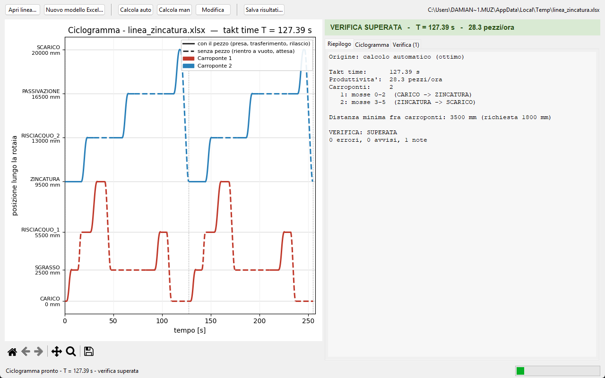
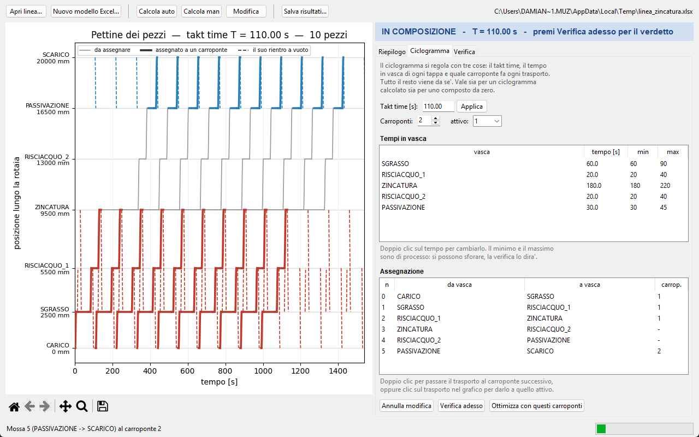

# Ciclogrammi carroponti (Cyclic Hoist Scheduling) con OR-Tools CP-SAT

Strumento per calcolare il ciclogramma periodico di uno o piu' carroponti
che spostano pezzi attraverso una sequenza di vasche, rispettando:

- tempi di permanenza min/max per vasca (tolleranza di processo),
- un takt time target con tolleranza,
- velocita'/accelerazione massime diverse per carroponte vuoto e carico,
- vincoli di non collisione fra carroponti sulla stessa rotaia.

Si usa da **interfaccia grafica**, da riga di comando o come libreria Python.
La linea si descrive in un file Excel e i risultati escono in Excel. Ogni
soluzione, calcolata o disegnata a mano, passa da un **verificatore
indipendente** che la ricontrolla senza usare il solutore.

## Perche' CP-SAT

Il problema è un **Cyclic Hoist Scheduling Problem (CHSP)**: un problema di
scheduling ciclico, NP-hard, con vincoli fortemente disgiuntivi (due
carroponti non possono occupare lo stesso punto di rotaia nello stesso
istante). La Constraint Programming — e nello specifico CP-SAT di OR-Tools —
è lo strumento standard in letteratura per questo tipo di problema, proprio
per la sua naturalezza nel esprimere vincoli disgiuntivi/di non-overlap e
periodici. È una scelta valida: il codice qui sotto la usa.

## I file del progetto

Quattordici file Python, divisi per ruolo. Le dipendenze vanno in una
direzione sola — interfaccia -> motore -> cinematica — e mai al contrario:
`model.py` non sa che esiste un'interfaccia, e `kinematics.py` non sa che
esiste un ciclogramma. E' quello che permette di provare il motore senza
aprire una finestra, e la cinematica senza avere OR-Tools installato.

```text
  interfaccia.py      ciclogramma.py      esempio.py        <- si lanciano
        |                   |                  |
        +-------------------+------------------+
        |            |            |            |
    excel_io.py  manuale.py  plotting.py   verify.py        <- contorno
        |            |            |            |
        +------------+-----+------+------------+
                           |
                       model.py                             <- motore (CP-SAT)
                           |
                     kinematics.py                          <- fisica
```

### Motore di calcolo

| file | righe | contenuto |
| --- | ---: | --- |
| `kinematics.py` | 130 | La fisica del movimento, in metri e secondi. `travel_time()` da' il tempo per percorrere una distanza con profilo trapezoidale o triangolare; `position_profile()` la posizione istante per istante; `profile_breakpoints()` gli spigoli della curva, che servono al verificatore per limitare in modo rigoroso l'errore di campionamento. Non sa nulla del resto del progetto. |
| `model.py` | 1711 | Il cuore. Contiene le **strutture dati** (`Tank`, `StationSpec`, `HoistZone`, `ProblemData`, `Segment`, `Solution`), la costruzione e risoluzione del **modello CP-SAT** (`solve`), la scelta automatica di zone e numero di carroponti (`solve_auto_zones`, `solve_auto_hoists`), e la costruzione di un ciclogramma **senza risolvere** a partire dai suoi gradi di liberta' (`build_solution`, `estrai_gradi_di_liberta`) — quest'ultima e' cio' che rende possibile l'editor. |
| `verify.py` | 980 | Il **verificatore indipendente**: `verify_solution()` ricontrolla una soluzione in Python puro, senza CP-SAT, campionando le posizioni reali dei carroponti. Restituisce un `VerificationReport` con l'elenco delle `Violation` divise per gravita'. E' la rete di sicurezza contro gli errori nella formulazione del modello. |
| `manuale.py` | 230 | Supporto al **disegno a mano**: il "pettine" dei pezzi (`pettine`, `catena_pezzo`), la composizione libera del ciclogramma (`componi`) e il controllo che i carroponti non si scavalchino sulla rotaia (`perche_non_va`). |

### Ingresso, uscita, disegno

| file | righe | contenuto |
| --- | ---: | --- |
| `excel_io.py` | 1099 | Tutto l'Excel: `scrivi_modello()` genera il file da compilare, `leggi_problema()` lo rilegge raccogliendo **tutti** gli errori di compilazione con foglio e cella, `scrivi_risultati()` produce il file dei risultati a quattro fogli. |
| `plotting.py` | 156 | `plot_cyclogram()`: disegna il ciclogramma (posizione lungo la rotaia contro tempo) con il profilo cinematico vero, non con segmenti diritti. |

### Programmi da lanciare

| file | righe | contenuto |
| --- | ---: | --- |
| `interfaccia.py` | 1574 | L'**interfaccia grafica** (tkinter). La classe `Applicazione` e' tutta la finestra: caricamento, calcolo in background, grafico incorporato, editor dei punti, disegno manuale, verifica e salvataggio. `autotest()` prova l'installazione da sola. E' il programma che usa un utente normale. |
| `ciclogramma.py` | 170 | Lo stesso lavoro da **riga di comando**, per chi preferisce il terminale o vuole automatizzare. |
| `esempio.py` | 195 | La linea di esempio definita **in codice** invece che in Excel, per chi vuole integrare il solutore in qualcos'altro. |
| `costruisci_exe.py` | 119 | Costruisce l'**eseguibile autonomo** con PyInstaller. Vedi sotto. |
| `ciclogrammi.spec` | — | La ricetta per PyInstaller: cosa includere, cosa escludere, come impacchettare. Non si lancia a mano, la usa `costruisci_exe.py`. |
| `Ciclogrammi.bat` | — | Avvia l'interfaccia con un doppio clic, senza aprire il terminale. |

### Test

Ogni file di test si lancia da solo (`python test_xxx.py`), stampa cosa ha
provato e restituisce un codice d'uscita diverso da zero se qualcosa non va.
Non serve pytest.

| file | righe | cosa verifica |
| --- | ---: | --- |
| `test_verify.py` | 831 | **Il verificatore.** Risponde a "chi verifica il verificatore?": venti casi, di cui uno solo corretto e tutti gli altri rotti di proposito (collisioni, permanenze fuori tolleranza, periodicita' incoerente, geometrie patologiche, capienze). Un controllore che non segnala mai nulla e' inutile, quindi ogni controllo ha un caso che DEVE farlo scattare. Non richiede OR-Tools: le soluzioni sono costruite a mano. |
| `test_model.py` | 393 | **Il modello CP-SAT.** Risolve davvero e passa ogni soluzione al verificatore: vasche ravvicinate, tre carroponti, capienza, tempi verticali, e la fedelta' della ricostruzione di una soluzione dai suoi gradi di liberta'. Richiede OR-Tools. |
| `test_excel_io.py` | 577 | **La lettura e la scrittura Excel.** Quasi tutti i casi sono file compilati male: valori mancanti o non numerici, vasche inesistenti o duplicate, righe riordinate, parametri sbagliati. Piu' la struttura del file dei risultati. Non richiede OR-Tools. |
| `test_interfaccia.py` | 530 | **Le funzioni dell'interfaccia grafica.** La finestra viene costruita davvero e pilotata da codice — si "premono" i pulsanti chiamando i metodi e si fa girare il ciclo degli eventi con `update()` invece di `mainloop()`. Verifica che i pulsanti si abilitino al momento giusto, che il calcolo in background consegni il risultato, che le modifiche vengano riverificate, che una modifica impossibile venga rifiutata senza schiantarsi, e che il disegno manuale produca il pettine giusto. Richiede OR-Tools e un ambiente grafico. |

`kinematics.py` ha in fondo un autotest che si lancia allo stesso modo
(`python kinematics.py`).

## Installazione ed esecuzione

```bash
pip install -r requirements.txt
```

Servono `ortools` (il solutore), `matplotlib` (il disegno) e `openpyxl` (i file
Excel). `pyinstaller` serve solo a chi deve costruire l'eseguibile.

## Come si usa l'interfaccia

Doppio clic su **`Ciclogrammi.bat`** (oppure `python interfaccia.py`, oppure
`Ciclogrammi.exe` se si usa la versione impacchettata).



La finestra e' divisa in tre: la **barra dei comandi** in alto, il
**ciclogramma** a sinistra, e a destra un **verdetto** sempre in vista con
sotto quattro schede. In basso una barra di stato che dice cosa sta facendo il
programma.

### Il giro completo, in breve

1. `Nuovo modello Excel...` — se non hai ancora un file, questo te lo crea gia'
   compilato con una linea di esempio.
2. Compili il file (vedi *Come modellare il tuo caso*, piu' sotto).
3. `Apri linea...` — lo carichi.
4. `Calcola automaticamente` oppure `Disegna a mano`.
5. Guardi il verdetto, eventualmente ritocchi.
6. `Salva risultati...` — esce l'Excel dei risultati e l'immagine.

### La barra dei comandi

| pulsante | cosa fa |
| --- | --- |
| `Apri linea...` | Carica un file Excel con la definizione della linea. Se il file e' compilato male non succede nulla di brutto: compare una finestra con **tutti** gli errori trovati, con foglio e cella. |
| `Nuovo modello Excel...` | Crea il file da compilare, gia' pieno con una linea di zincatura d'esempio, e chiede se aprirlo subito. E' il modo consigliato di cominciare: si parte da qualcosa che funziona e lo si modifica. |
| `Calcola automaticamente` | Cerca il numero minimo di carroponti, la suddivisione migliore della linea e il takt time piu' basso. Puo' durare da qualche secondo a qualche minuto: la barra in basso a destra si muove e i pulsanti restano disabilitati finche' non ha finito. La finestra **non si blocca**. |
| `Disegna a mano` | Passa alla composizione manuale (vedi sotto). |
| `Salva risultati...` | Scrive l'Excel dei risultati e, accanto, l'immagine del ciclogramma. Si abilita solo quando c'e' qualcosa da salvare. |

### Il verdetto

La striscia colorata in alto a destra e' l'informazione piu' importante, e per
questo non finisce mai dentro una scheda:

- **verde** — `VERIFICA SUPERATA`, con takt time e pezzi/ora. Il ciclogramma e'
  fisicamente valido e rispetta tutte le tolleranze dichiarate.
- **rosso** — quanti errori sono stati trovati. Il dettaglio e' nella scheda
  *Verifica*.
- **azzurro o arancio** — sei in disegno manuale, i controlli sono sospesi.

### Le quattro schede

**Riepilogo** — takt time, produttivita' in pezzi/ora, quanti carroponti e che
tratto di linea serve ciascuno, distanza minima raggiunta fra i carri contro
quella richiesta.

**Modifica** — per ritoccare un ciclogramma gia' calcolato. Vedi sotto.

**Disegno** — per comporlo a mano. Vedi sotto.

**Verifica** — l'elenco dei rilievi del verificatore indipendente, colorati per
gravita': rosso gli errori, arancio gli avvisi, grigio le note. Le descrizioni
sono lunghe: **clic su una riga** per leggerla per intero.

La differenza fra i tre livelli conta. Un **errore** vuol dire che il
ciclogramma non e' utilizzabile (una collisione, una permanenza fuori
tolleranza). Un **avviso** segnala qualcosa che il modello non sa vincolare e
che va guardato a mano. Una **nota** e' informativa: per esempio che una vasca
lavora con due pezzi dentro contemporaneamente, il che e' normale se e' a due
posti.

### Modificare un ciclogramma calcolato

Un ciclogramma ha pochissimi gradi di liberta' reali: il **takt time**,
l'**istante di prelievo** di ogni mossa, quanti **periodi interi** il pezzo
resta in vasca oltre il minimo, e **quale carroponte** fa cosa. Tutto il resto
— traiettorie, tempi assoluti, ordine di visita — e' conseguenza. La scheda
*Modifica* espone esattamente quelli, in tre modi:

- **Trascinando sul grafico.** Prendi un punto di prelievo — l'inizio di un
  tratto colorato — e spostalo a destra o a sinistra. Mentre trascini, una guida
  arancione mostra dove finira' e la barra di stato dice di quanti secondi lo
  stai spostando.
- **Dalla tabella delle mosse.** Doppio clic sulla colonna `prelievo [s]` per
  scrivere l'istante esatto, o sulla colonna `giri` per far restare il pezzo in
  vasca un takt in piu'.
- **Takt time e numero di carroponti**, in alto nella scheda.

**A ogni modifica il ciclogramma viene ricostruito da capo e riverificato**: il
verdetto e l'elenco dei rilievi si aggiornano subito. Se una modifica rendesse
il ciclogramma impossibile — per esempio il carroponte non farebbe in tempo ad
arrivare — viene **rifiutata**, lo stato torna com'era e la barra in basso
spiega perche'. Meglio di un grafico che sparisce.

`Annulla modifica` torna indietro di un passo, e si puo' premere piu' volte.

`Rifai il calcolo automatico` ricalcola tutto da zero: **le modifiche fatte a
mano vengono perse.**

Attenzione a `Carroponti`: cambiarlo non e' una modifica come le altre. Le fasi
di prelievo erano state scelte per un'altra suddivisione della linea e quasi
mai restano realizzabili con una diversa, quindi il programma **ricalcola** la
miglior soluzione per quel numero di carroponti.

### Comporre un ciclogramma a mano

`Disegna a mano` apre il **pettine**: dieci scalinate grigie, una per ogni pezzo
in lavorazione, distanziate esattamente di un takt time. Ogni scalinata mostra
le soste in vasca (tratti orizzontali) e i trasporti (tratti che salgono).



E' il metodo con cui i ciclogrammi si tracciano a mano da sempre: prima il
pettine dei pezzi, poi si decide quali trasporti fa ciascun carroponte.

- **Clic su un trasporto** per assegnarlo al carroponte attivo (si sceglie con
  il menu `attivo`). Il trasporto assegnato prende il colore del carroponte, e
  compaiono le linee tratteggiate dei suoi rientri a vuoto.
- **Doppio clic su un tempo in vasca** per cambiarlo: le scalinate si spostano
  da quel punto in poi, e magari a quel punto conviene assegnare diversamente.
  La tabella mostra accanto il minimo e il massimo di processo, ma **non
  impedisce** di uscirne.
- **Doppio clic su una riga della tabella `Assegnazione`** per passare il
  trasporto al carroponte successivo.

**Durante il disegno i controlli sono sospesi.** Si compone liberamente, e anche
un ciclogramma impossibile viene disegnato lo stesso: i tratti che il carroponte
non farebbe in tempo a percorrere sono **in rosso spesso** sul grafico e
descritti uno per uno nella scheda *Riepilogo*, per esempio cosi':

```text
dalla mossa 3 non si fa in tempo ad arrivare alla mossa 5: il carroponte
sarebbe pronto a 140,1 s ma il prelievo e' a 98,1 s, 42,0 s troppo tardi
```

Il report completo — permanenze, collisioni, capienze, takt time — arriva
quando si preme `Verifica adesso`.

`Torna all'automatico` abbandona il disegno e fa ricalcolare tutto al solutore.

L'unica cosa che resta impedita e' assegnare i trasporti in modo che due
carroponti debbano **scavalcarsi** sulla rotaia. Non e' una regola del modello:
e' la rotaia. Il messaggio lo dice, e il doppio clic sulla tabella propone solo
i carroponti che possono davvero prendersi quella mossa.

### Se il calcolo non trova niente

Capita, ed e' un'informazione: vuol dire che con i dati dati la linea non sta in
piedi. Il riepilogo elenca cosa provare — allargare la tolleranza sul takt time,
aumentare il numero massimo di carroponti, aggiungere posti alle vasche piu'
lente, allungare il tempo limite di calcolo. In alternativa `Disegna a mano`, e
si guarda dove il conto non torna: li' non c'e' niente da trovare, si vede.

## Cosa produce

Sia l'interfaccia sia la riga di comando producono, accanto al file di
ingresso:

- **`linea_risultati.xlsx`** — quattro fogli:

  | foglio | contenuto |
  | --- | --- |
  | `Riepilogo` | takt time, **produttivita' in pezzi/ora**, numero di carroponti, zone e tratto di rotaia servito, **utilizzo di ciascun carroponte**, distanza minima raggiunta contro quella richiesta, esito della verifica |
  | `Movimenti` | una riga per tratto: carroponte, fase (presa, trasporto, rilascio, spostamento a vuoto, attesa), vasca di partenza e arrivo, istanti di inizio e fine, durata, posizioni. E' la tabella da passare a chi programma il PLC |
  | `FlussoPezzo` | il percorso di **un** pezzo lungo tutta la linea: ingresso e uscita da ogni vasca, permanenza effettiva, margine rispetto ai limiti di processo, posti occupati |
  | `Verifica` | l'elenco dei rilievi del verificatore indipendente, colorati per gravita' |

- **`linea.png`** — il ciclogramma disegnato.

Il comando stampa anche a video il takt time e il report della verifica.
Altre opzioni: `--risultati FILE.xlsx`, `--grafico FILE.png`, `--cicli N`,
`--niente-grafico`, `--niente-excel`, `--log`.

Gli errori di compilazione vengono raccolti **tutti insieme**, con foglio e
cella, cosi' si corregge il file in una volta sola:

```text
Il file 'linea.xlsx' non e' compilato correttamente:
  - [Vasche!B3] posizione: atteso un numero, trovato 'due metri'
  - [Percorso!B4] la vasca 'SGRASSAGGIO' non e' definita nel foglio Vasche
  - [Parametri!A2] parametro 'takt_minimo' non riconosciuto. Quelli ammessi sono: ...
```

I numeri scritti con la virgola decimale (`2,5`) vengono accettati.

## Altri modi di usarlo

### Da riga di comando

```bash
python ciclogramma.py --modello linea.xlsx    # crea il file da compilare
# ... compili linea.xlsx ...
python ciclogramma.py linea.xlsx              # calcola il ciclogramma
```

Il modello generato e' gia' compilato con una linea di zincatura d'esempio, in
modo che si possa lanciare subito e poi modificarlo pezzo per pezzo. Ha cinque
fogli:

| foglio | contenuto |
| --- | --- |
| `Istruzioni` | come compilare gli altri fogli |
| `Vasche` | id, posizione lungo la rotaia, numero di posti, corsa verticale, sgocciolamento |
| `Percorso` | sequenza di vasche attraversate, con le permanenze |
| `Parametri` | takt time, cinematiche, ingombri, tempi verticali, opzioni |
| `Zone` | facoltativo: suddivisione manuale delle mosse fra i carroponti. **Lasciandolo vuoto** numero di carroponti e zone vengono scelti automaticamente |

### Uso da Python

`esempio.py` mostra come definire la stessa linea direttamente in codice e
richiamare il solutore, se serve integrarlo in qualcos'altro:

```bash
python esempio.py
```

## Creare l'eseguibile per PC senza Python

Serve PyInstaller una volta sola:

```bash
pip install pyinstaller
```

Poi, dalla cartella del progetto, **un comando**:

```bash
python costruisci_exe.py
```

Ci vogliono un paio di minuti. Al termine si trova tutto in
`dist/Ciclogrammi/`, circa 290 MB: si copia **la cartella intera** sul PC di
destinazione e si lancia `Ciclogrammi.exe`. Non serve installare ne' Python
ne' altro.

Con `--con-test` il comando esegue prima l'intera suite di test, e non
impacchetta se qualcosa non passa. Non e' obbligatorio, ma e' l'unico modo per
non scoprire un problema in stabilimento.

### Verificare che funzioni davvero

Sul PC di destinazione, una volta sola:

```bash
Ciclogrammi.exe --autotest
```

Crea un file di esempio, lo rilegge, calcola il ciclogramma, lo verifica, salva
i risultati e scrive un `autotest.txt` con l'esito. Trenta secondi.

Non e' una formalita': **che l'eseguibile si costruisca non vuol dire che
funzioni.** Durante la messa a punto il pacchetto veniva creato senza il
minimo errore, si apriva regolarmente, e poi moriva al primo calcolo con
`No module named 'pandas'` — perche' OR-Tools importa pandas internamente e
lo spec lo escludeva come alleggerimento. Un problema del genere, scoperto
davanti al cliente, e' un'altra faccenda.

### Perche' una cartella e non un singolo file

Con OR-Tools e matplotlib dentro, un `--onefile` supera i 280 MB e a **ogni
avvio** deve scompattarsi in una cartella temporanea: decine di secondi di
attesa tutte le volte. La cartella si copia tale e quale e parte subito.

### Se serve rimettere le mani nello spec

`ciclogrammi.spec` e' la ricetta per PyInstaller. Due punti delicati:

- **`excludes`**: qui si tolgono i pacchetti inutili per alleggerire. Attenzione
  a `pandas`: il progetto non lo usa, ma OR-Tools si', quindi non va escluso.
  Vale la regola generale che un pacchetto va tolto solo se si e' sicuri che
  nessuna dipendenza lo importi.
- **`console=False`**: niente finestra nera all'avvio. Come contropartita, un
  errore all'avvio sarebbe invisibile, quindi `interfaccia.py` lo intercetta e
  lo mostra in una finestra di dialogo.

## Come modellare il tuo caso

1. **Vasche** (`Tank`): id, posizione `[m]` lungo la rotaia, numero di posti
   simultanei (`capacity`, default 1) e, facoltativi, corsa verticale
   (`lift_height`) e sgocciolamento (`drain_time`) propri di quella vasca.
2. **Percorso** (`route`, lista di `StationSpec`): sequenza di vasche che il
   pezzo attraversa, con tempo di permanenza `[min,max]` in secondi. La stessa
   vasca puo' comparire piu' volte.
   Assunzione v1: **un solo percorso condiviso da tutti i pezzi**.
3. **Cinematica**: `Kinematics(v_max, a_max)` separata per carroponte vuoto
   e carico.
4. **Takt time**: `takt_min`, `takt_max` (puoi calcolarli da
   `nominale ± tolleranza`).
5. **Carroponti e zone** (`HoistZone`): ogni carroponte serve una **zona
   contigua** di mosse (indici di trasporto, non di vasca). Ci sono tre
   modi per specificarli, dal piu' al meno automatico:
   - **numero di carroponti + zone entrambi automatici**: usa
     `solve_auto_hoists(data, max_hoists=...)` — cerca il numero minimo di
     carroponti che rispetta il takt time dato, e per ciascuno le zone
     migliori;
   - **numero di carroponti fissato, zone automatiche**: passa
     `zones=None` a `ProblemData` e usa
     `solve_auto_zones(data, n_hoists=...)`;
   - **tutto manuale**: specifica `zones` (lista di `HoistZone`) e usa
     `solve(data)` direttamente, se hai gia' un'idea precisa di come
     dividere la linea.
6. **Sicurezza**: `hoist_extent_pos`, `hoist_extent_neg` (ingombro del
   carrello, vedi sotto) e `safety_distance` (margine minimo aggiuntivo).
7. **Movimentazione verticale**: `lift_height`, `kin_lift_empty`,
   `kin_lift_loaded`, `engage_time`, `disengage_time`, `drain_time`
   (vedi sotto).

### Ingombro del carroponte

La posizione di un carroponte e' quella del suo **gancio**, che deve stare
sopra la vasca. Il carrello attorno al gancio non e' detto sia simmetrico, per
cui i due lati si dichiarano separatamente:

- `hoist_extent_pos` — quanto sporge verso le posizioni **crescenti**;
- `hoist_extent_neg` — quanto sporge verso le posizioni **decrescenti**.

La distanza minima richiesta fra i ganci di due carroponti e'

```text
D = hoist_extent_pos + hoist_extent_neg + safety_distance
```

Vale la pena capire **perche' compare solo la somma**. Se il carroponte di
sinistra ha il gancio in `p` e quello di destra in `q`, il bordo destro del
primo sta in `p + pos` e il bordo sinistro del secondo in `q - neg`: lo spazio
libero fra i due vale `q - p - (pos + neg)`. Dove sia il gancio *dentro* il
carrello non entra nel conto — a parita' di lunghezza totale, spostarlo avanti
o indietro non cambia nulla, perche' quello che si guadagna da un lato lo si
perde dall'altro.

Dichiararli separati resta comunque utile: rende esplicito che le posizioni
delle vasche sono riferite al gancio e non al centro del carrello, ed e' il
dato giusto da avere se un giorno servisse vincolare il carroponte rispetto a
strutture fisse o usare carroponti di modelli diversi sulla stessa rotaia.

### Capienza delle vasche (`capacity`)

`Tank.capacity` e' il numero di **posti simultanei** nella vasca, e vale `1`
per default. E' una proprieta' della **vasca fisica**, non della tappa del
percorso: se la ricetta passa due volte dalla stessa vasca, i pezzi delle due
tappe si contendono gli stessi posti.

Un pezzo tiene occupato un posto per

```text
occupazione = release_time + dwell + pick_time
```

— non solo il tempo in bagno: il telaio ingombra il posto dall'inizio
dell'immersione fino alla fine dell'emersione.

Per una vasca usata **una sola volta** nella ricetta i pezzi contemporaneamente
presenti sono `ceil(occupazione / T)`, e il modello impone

```text
occupazione <= capacity * T
```

che e' esattamente equivalente. `capacity` e' una costante intera e `T` una
variabile, quindi il vincolo resta lineare e non costa praticamente nulla.

Per una vasca usata **piu' volte** serve altro. Sommare i massimi delle singole
tappe sarebbe cautelativo e scarterebbe soluzioni valide: le tappe possono
essere sfasate fra loro, e allora un posto solo puo' bastare per entrambe. Il
modello usa quindi un vincolo **cumulativo** esatto — ogni pezzo occupa un
posto per il suo intervallo, gli intervalli si ripetono ogni `T`, e in nessun
istante se ne possono sovrapporre piu' di `capacity`. Verificato: su una linea
che passa due volte dalla stessa vasca con permanenze brevi, il modello trova
una soluzione con **un posto solo**, sfasando le due tappe.

Il default `1` e' deliberatamente il caso restrittivo: obbliga a **dichiarare**
le vasche multi-posto invece di lasciarlo implicito. Conseguenza pratica: con
`capacity=1` il takt time non puo' scendere sotto l'occupazione della vasca
piu' lenta. Nell'esempio ZINCATURA ha una permanenza di ~190 s con takt 110 s,
quindi e' dichiarata `capacity=2`.

Se una vasca e' irrimediabilmente insufficiente
(`release + dwell_min + pick > capacity * takt_max`), `ProblemData` lo rifiuta
subito con un messaggio esplicito, invece di lasciar restituire un
`INFEASIBLE` muto dopo minuti di ricerca.

Un limite da conoscere: la prima e l'ultima stazione (carico/scarico) sono
fuori dalla catena delle permanenze e quindi **non** hanno vincolo di capienza.

### Movimentazione verticale (presa e rilascio)

Il carroponte non si limita a traslare: cala il gancio, aggancia e tira su il
telaio, e all'arrivo lo immerge, sgancia e risale. I tempi **non si
dichiarano**: si ricavano dalla corsa verticale e dalle cinematiche di
sollevamento, con lo stesso profilo trapezoidale usato per il moto
orizzontale.

- `lift_height` — corsa fra quota di trasporto e quota di immersione;
- `kin_lift_empty`, `kin_lift_loaded` — velocita' e accelerazione massime di
  sollevamento, a gancio scarico e col telaio;
- `engage_time` — aggancio del telaio, prima del sollevamento (tempo morto);
- `disengage_time` — sgancio, dopo l'immersione (tempo morto);
- `drain_time` — **sgocciolamento**: quanto il telaio resta sospeso sopra la
  vasca a lasciar scolare il bagno, dopo l'emersione.

Da cui:

```text
presa    = discesa a vuoto  + aggancio + risalita a carico + sgocciolamento
rilascio = discesa a carico + sgancio  + risalita a vuoto
```

Lo sgocciolamento sta **solo** nella presa: si scola uscendo dalla vasca, non
entrandoci.

Ne segue una cosa che vale la pena notare: **presa e rilascio percorrono le
stesse due tratte** (una a vuoto e una a carico), solo in ordine invertito, e
quindi differiscono unicamente per i tempi morti.

Due grandezze si dichiarano **per vasca**, perche' non dipendono dal
carroponte:

- `Tank.lift_height` — le vasche piu' profonde hanno corse piu' lunghe;
- `Tank.drain_time` — lo sgocciolamento dipende dalla chimica del bagno e dalla
  geometria del pezzo: sulla zincatura e' lungo, su un risciacquo quasi nullo.

Lasciandole vuote si usa il valore generale. Nell'esempio ZINCATURA ha corsa
1,1 m contro 0,8 m e sgocciolamento 8 s contro 2 s: la sua presa vale 17,09 s
contro i 9,49 s delle altre vasche.

Con `lift_height = 0` le cinematiche di sollevamento non servono e restano solo
i tempi morti: e' la via da usare se si hanno tempi gia' misurati sul campo
invece della meccanica.

Ogni mossa dura quindi `presa + traslazione + rilascio`. Lo spostamento **a
vuoto non paga alcun tempo verticale**: dopo lo sgancio il gancio e' gia' in
alto (ce lo ha portato il rilascio) e ridiscendera' dentro la presa della mossa
successiva — contarlo di nuovo sarebbe doppio conteggio.

Conseguenza importante per l'interpretazione dei dati di processo: i tempi di
permanenza (`dwell_min`/`dwell_max`) restano il tempo **effettivo in bagno**,
misurato da fine immersione a inizio emersione. Non vanno gonfiati a mano per
tenere conto delle fasi verticali.

Le due fasi compaiono nel ciclogramma come segmenti orizzontali dedicati
(`Segment.kind` vale `"pick"` o `"release"`), in arancio e viola: il
carroponte e' fermo sopra la vasca. Con tempi verticali nulli non viene emesso
alcun segmento e il risultato torna quello di una linea senza sollevamento.

Attenzione al dimensionamento: i tempi verticali si sommano a **ogni** mossa e
si fanno sentire in fretta. Nell'esempio fornito valgono da 16 a 25 s per mossa,
cioe' oltre 100 s di contenuto su 6 mosse: abbastanza da far passare la linea da
1 a 2 carroponti e da alzare il takt time da 110 a 132 s. E' un risultato
corretto, non una regressione — e' esattamente la ragione per cui vale la pena
modellarli invece di stimarli a occhio. Lo sgocciolamento, in particolare, e' il
contributo che si tende a dimenticare: portarlo da 2 a 15 s sulla sola zincatura
fa passare l'esempio a 3 carroponti.

### Scelta automatica del numero di carroponti e delle zone

```python
data = ProblemData(..., zones=None, ...)
solution, zones, n_hoists = solve_auto_hoists(data, max_hoists=4, time_limit_per_candidate=15.0,
                                               log_progress=True)
```

`solve_auto_hoists` prova N = 1, 2, 3, ... carroponti (fino a `max_hoists`)
in ordine crescente e si ferma al **primo** N per cui esiste una
suddivisione in zone fattibile entro la tolleranza di takt time data —
poiche' aggiungere carroponti puo' solo ampliare cio' che e' fattibile
(mai restringerlo), il primo N fattibile e' anche il minimo. Per ciascun N
tentato, internamente chiama `solve_auto_zones` (vedi sotto). Se nessun N
fino a `max_hoists` e' fattibile, `solution.status` sara' `"INFEASIBLE"` e
`zones`/`n_hoists` saranno `None` — in tal caso prova ad aumentare
`max_hoists` o la tolleranza sul takt time. Il dettaglio di ogni tentativo
(N, esito, T se trovato) e' anche in `solution.raw["hoist_sweep"]`.

### Scelta automatica delle sole zone (numero di carroponti fissato)

```python
data = ProblemData(..., zones=None, ...)
solution, zones = solve_auto_zones(data, n_hoists=2, time_limit_per_candidate=15.0,
                                    log_progress=True)
```

`solve_auto_zones` prova **tutte** le suddivisioni contigue possibili delle
mosse in `n_hoists` zone (scartando a priori, senza invocare CP-SAT, quelle
palesemente infattibili: una zona il cui solo trasporto-a-carico supera
gia' da solo il takt time massimo) e tiene la soluzione con il takt time
minore fra quelle fattibili. Il numero di suddivisioni possibili e'
`C(n_moves-1, n_hoists-1)`: per una manciata di carroponti e qualche decina
di mosse resta gestibile, ma cresce in fretta — il parametro
`max_candidates` (default 500) fa fallire la chiamata con un messaggio
chiaro se la ricerca esaustiva rischia di essere troppo lunga, cosi' puoi
decidere se aumentarlo, ridurre il problema, o specificare le zone a mano.

Nota: `data.zones` resta `None` dopo la chiamata (non viene modificato);
usa `zones` (il secondo valore restituito) — ad es. con
`dataclasses.replace(data, zones=zones)` — se ti serve un `ProblemData`
completo per altri usi (es. richiamare `plot_cyclogram`).

## Verifica indipendente della soluzione

```python
from verify import verify_solution

report = verify_solution(data_final, solution)   # data_final ha le zone valorizzate
print(report.summary())
if not report.ok:
    ...
```

`esempio.py` la esegue automaticamente dopo ogni risoluzione.

Il verificatore **non usa CP-SAT**: riparte dalla soluzione e ricontrolla ogni
vincolo in Python puro. Serve a rispondere alla domanda "e se fosse sbagliata
la formulazione stessa del modello?" — in quel caso il solver restituisce
comunque una soluzione dichiarata `OPTIMAL` e nulla se ne accorgerebbe.
Controlla:

1. struttura (takt time nella banda, zone contigue e coprenti);
2. **layout**: stazioni cosi' vicine a un confine di zona che il modello non
   le vincola (vedi sotto);
3. coerenza dei segmenti (continuita' nel tempo e nello spazio, ciclo di
   durata esattamente T, traiettoria che si richiude);
4. copertura delle mosse e durate delle tratte contro la cinematica reale;
5. coerenza di fase, cioe' la linearizzazione modulo T del modello;
6. permanenze min/max in vasca, dai tempi **assoluti**;
7. fattibilita' degli spostamenti a vuoto;
8. **collisioni reali**: la posizione di ogni carroponte viene campionata con
   `position_profile` (il profilo cinematico vero, non solo gli estremi delle
   finestre) e si controlla `|x_i(t) - x_j(t)| >= hoist_length + safety_distance`
   per ogni coppia e ogni istante;
9. capienza delle vasche: quanti posti servono davvero contro quanti sono
   dichiarati in `capacity`.

Il campionamento del punto 8 include **tutti** gli spigoli dei profili
cinematici piu' una griglia uniforme di un tick. Fra due spigoli la posizione
e' un polinomio di grado ≤ 2, quindi l'errore del minimo cosi' trovato e'
limitato in modo rigoroso da `(a_i + a_j)·dt²/8` — circa 0,02 mm con i valori
di default. Il valore e' riportato in `report.sampling_error_bound`.

### Verificatore e modello si controllano a vicenda

Il verificatore pretende `hoist_length + safety_distance` fra i due carroponti
**ovunque e sempre**, campionando la posizione reale. Il modello impone la
stessa cosa, ma per una via completamente diversa (vincoli lineari su
intervalli temporali, vedi sotto). Due strade indipendenti verso lo stesso
requisito: e' quello che rende la verifica utile invece che tautologica.

Storicamente il modello riservava l'intera finestra di sosta alla sola
stazione di **confine**, gonfiata di un buffer ricavato da *mezzo* ingombro.
Sul confine il criterio reggeva — la non sovrapposizione delle finestre separa
partenza e arrivo di due buffer, e poiche' lo spazio percorso da fermo cresce
in modo convesso, nell'istante peggiore entrambi i carroponti sono ad almeno
mezzo ingombro dal confine, su lati opposti.

**La garanzia cadeva in un caso preciso**: se un'altra stazione delle due zone
distava meno di `hoist_length + safety_distance` dal confine, il carroponte ci
sostava dentro la zona di esclusione del vicino, e nessun vincolo lo impediva.
Il modello ora non ragiona piu' in termini di "occupazione della stazione di
confine" ma di posizione reale nel tempo: vedi la sezione seguente.

## Non collisione: la fascia di esclusione

Attorno alla stazione di confine `b` fra due zone adiacenti, siano `a(t)` la
distanza del carroponte di sinistra da `b` e `c(t)` quella del carroponte di
destra. Poiche' le due zone stanno su lati opposti, la distanza fra i due
carroponti e' esattamente `a(t) + c(t)`, e serve

```text
a(t) + c(t) >= D          con D = hoist_length + safety_distance
```

Non e' esprimibile direttamente in CP-SAT, ma per ogni soglia `r` vale una
condizione **locale e lineare** che ne e' un'implicazione:

```text
mai contemporaneamente   a(t) < r   e   c(t) <= D - r
```

Vieta solo configurazioni con `a + c < D`, quindi non taglia mai nulla di
sicuro. Imponendola su una griglia di soglie abbastanza fitta si copre l'intera
condizione: se `a + c < D` basta una soglia nell'intervallo `(a, D - c]`, che e'
lungo piu' del passo della griglia. Usando passo `δ = D / clearance_steps` e
portando il bersaglio a `D + δ`, **la distanza garantita torna esattamente D**.

"`a(t) < r`" e' un'unione di intervalli temporali calcolabile dal modello: il
carroponte e' dentro la fascia mentre sosta su una stazione a distanza `< r`,
e per i tratti di percorso che ci entrano — con un margine costante, perche'
le vasche sono in posizioni fisse e quindi tutti i tempi di percorrenza lo
sono. La traiettoria di un periodo viene partizionata in blocchi (una mossa;
un trasferimento a vuoto) e dentro ogni blocco la distanza dal confine e'
monotona, il che rende il calcolo esatto.

Conseguenze pratiche:

- **le vasche possono stare vicine quanto si vuole.** Con passo 1,0 m e
  `D = 1,80 m` il modello trova soluzioni in cui i due carroponti sostano uno
  alla stazione precedente e uno alla successiva del confine: 2,0 m di
  separazione, sicuri. E' proprio la configurazione che il modello precedente
  non sapeva rappresentare;
- **se davvero non ci stanno, esce INFEASIBLE**, non una soluzione sbagliata.
  Con passo 0,80 m, mentre un carroponte e' sul confine l'altro non ha nessuna
  stazione abbastanza lontana in cui sostare: corretto;
- il vincolo e' anche **meno cautelativo del precedente**, che garantiva
  `hoist_length + 2·safety_distance` invece dei richiesti
  `hoist_length + safety_distance`.

### Il parametro `clearance_steps`

Regola la finezza della griglia di soglie (default 6). La distanza garantita
e' sempre quella richiesta: alzarlo riduce la **conservativita'**, cioe'
permette takt time piu' bassi, al prezzo di un modello piu' grande. Misurato
su una linea a 4 mosse con passo 1,5 m:

| `clearance_steps` | takt time | separazione reale |
| ---: | ---: | ---: |
| 2 | 18,86 s | 3,000 m |
| 4 | 14,39 s | 2,985 m |
| 8 | 13,45 s | 2,545 m |

Sotto i 4 passi la conservativita' si vede, sopra i 12 il modello cresce senza
gran guadagno.

**Attenzione alla larghezza della banda di takt time.** Il numero di copie
traslate da generare e' calcolato sul caso peggiore `T = takt_min`, quindi una
banda molto larga (`takt_max` molte volte `takt_min`) fa crescere parecchio il
modello. Se la risoluzione diventa lenta, stringere la tolleranza sul takt time
e' la prima cosa da provare.

### Cosa resta non rappresentabile

Solo la geometria patologica: vasche non ordinate lungo la rotaia, con zone
adiacenti che si scavalcano o zone lontane che si sovrappongono nello spazio.
`model.zone_layout_conflicts(data, zones)` la rileva, `solve()` la rifiuta con
un messaggio esplicito, e `solve_auto_zones` la usa come pre-filtro accanto a
quello sul takt time — cosi' la scelta automatica delle zone trova da sola una
suddivisione valida quando esiste.

## Assunzioni e limitazioni importanti (leggere prima di fidarsi dei risultati)

Il modello implementato (vedi commenti dettagliati in testa a `model.py`)
fa scelte di modellazione precise, in particolare:

- **Zone contigue**: ogni carroponte gestisce sempre un gruppo contiguo di
  mosse (stazioni). E' l'approccio piu' diffuso nella pratica industriale,
  ma non e' la formulazione piu' generale possibile (un carroponte non puo'
  "scavalcare" il territorio di un altro).
- **Le zone sono scelte per enumerazione esaustiva, non dentro al modello
  CP-SAT**: `solve_auto_zones` risolve un modello CP-SAT separato per
  ciascuna suddivisione candidata e tiene la migliore, invece di rendere il
  confine fra zone una variabile del modello unico. E' una scelta
  deliberatamente piu' semplice e robusta (riusa `solve()` cosi' com'e',
  gia' testato) a scapito della scalabilita' per problemi con molte mosse e
  molti carroponti — vedi `max_candidates`.
- **Ordine di visita libero entro la zona**: ogni carroponte puo' visitare
  le mosse della propria zona in QUALSIASI ordine ad ogni ciclo (non
  costretto a un unico giro sequenziale + un solo rientro), modellato con
  un vincolo di circuito ciclico (`AddCircuit`). Questo permette di trovare
  un ciclogramma fattibile anche quando il tempo "a calendario" della zona
  (attese nelle vasche incluse) supera abbondantemente il takt time: il
  carroponte puo' andare a servire un'altra mossa mentre un pezzo e'
  ancora a bagno, invece di restare fermo ad aspettare. Il vincolo che
  resta davvero rigido e' che la somma dei tempi di trasporto carico e dei
  trasferimenti a vuoto necessari (esclusi i tempi di attesa nelle vasche)
  stia entro il takt time: se anche questo viene superato, nessun ordine
  di visita puo' risolvere il problema.
- **Collisioni vincolate attorno ai confini di zona**: e' l'unica regione in
  cui due carroponti possono avvicinarsi in questa formulazione (zone
  contigue). Il vincolo tiene conto della posizione reale nel tempo e funziona
  con qualunque spaziatura fra le vasche, ma resta leggermente conservativo:
  puo' scartare soluzioni "al limite" che in pratica sarebbero fattibili.
  Quanto, lo regola `clearance_steps` (vedi "Non collisione").
- **Posizione di attesa non scelta dal solver**: per convenzione un carroponte
  che ha consegnato riparte subito e attende alla stazione della mossa
  successiva. Poterlo far attendere altrove gli darebbe piu' modo di
  allontanarsi dal vicino.
- **Capienza delle vasche**: vincolata tramite `Tank.capacity`, in modo esatto
  anche quando la stessa vasca compare piu' volte nella ricetta, ma solo per le
  stazioni intermedie (carico e scarico restano fuori).
- **Un solo percorso vasche** condiviso da tutti i pezzi (nessun mix di
  prodotti diversi in questa versione).

Nella sezione finale di `model.py` ("Estensioni possibili") sono descritte
le direzioni per superare le limitazioni residue (assegnazione non
contigua fra zone, piu' ricette, collisione meno conservativa).

## Nota sui test effettuati

```bash
python kinematics.py        # autotest della cinematica
python test_verify.py       # il verificatore              (no OR-Tools)
python test_excel_io.py     # lettura e scrittura Excel    (no OR-Tools)
python test_model.py        # il modello CP-SAT            (serve OR-Tools)
python test_interfaccia.py  # l'interfaccia grafica        (serve OR-Tools)
python esempio.py           # risoluzione reale + verifica + grafico
```

Ognuno stampa cosa ha provato e finisce con `RISULTATO: n ok, m falliti`.
Nessuna dipendenza da pytest. Stato attuale: **65, 54, 24 e 50 asserzioni,
zero fallimenti**.

**La risoluzione CP-SAT e' eseguita e verificata end-to-end.** Sull'esempio
fornito il solver trova `T = 131,88 s` con 2 carroponti, separazione minima
3,50 m contro 1,80 m richiesti, e il verificatore indipendente conferma la
soluzione senza errori.

I quattro file rispondono a domande diverse e si completano:

- `test_verify.py` — 20 casi. *Il verificatore trova davvero quello che deve
  trovare?* Uno solo dei casi e' corretto, gli altri sono rotti di proposito
  (collisioni, permanenze, periodicita', fasi verticali, capienza, geometrie
  patologiche). Le soluzioni sono costruite a mano, quindi non serve OR-Tools.
- `test_model.py` — 9 casi. *Il modello produce soluzioni fisicamente valide?*
  Risolve davvero e passa ogni risultato al verificatore.
- `test_excel_io.py` — 18 casi. *Un file compilato male viene respinto con un
  messaggio utile, e i risultati escono corretti?* In ingresso: valori mancanti
  o non numerici, vasche inesistenti o duplicate, righe riordinate, parametri
  sbagliati, zone incomplete. In uscita: struttura dei fogli, corrispondenza
  fra tratti e vasche, somma delle durate pari al takt time.
- `test_interfaccia.py` — 8 casi. *L'interfaccia si comporta come deve?* La
  finestra viene costruita davvero e pilotata da codice. E' l'unico modo per
  accorgersi che un pulsante e' rimasto disabilitato, che il calcolo in
  background non consegna mai il risultato, o che una modifica impossibile
  manda tutto per aria invece di essere rifiutata: cose che un test sulle sole
  funzioni di calcolo non vedrebbe.

In piu', il vincolo di non collisione e' stato validato su uno **sweep di 288
configurazioni** (numero di mosse, spaziatura da 1,0 a 3,0 m, tempi verticali,
`clearance_steps`, punto di taglio delle zone): 146 risolte e verificate,
**zero errori**. Come controllo di sensibilita', lo stesso sweep con il vincolo
disattivato produce 159 soluzioni con collisioni reali — se ci fosse un buco
nella formulazione, lo sweep lo avrebbe visto.

### Cosa ha gia' trovato il verificatore

Non e' un esercizio teorico: da quando esiste ha intercettato tre problemi
reali, tutti invisibili guardando solo lo stato `OPTIMAL` del solver.

1. **Collisioni con vasche ravvicinate** — con spaziatura inferiore a
   `hoist_length + safety_distance`, CP-SAT restituiva soluzioni `OPTIMAL`
   con i carroponti a 1,24 m invece di 1,80 m, perche' il vincolo copriva solo
   la stazione di confine. **Corretto** riformulando la non collisione sulla
   fascia di esclusione (vedi sopra): ora quelle geometrie si risolvono, e
   correttamente.
2. **Finestre di occupazione da correggere per i tempi verticali** — l'aggiunta
   di `pick_time`/`release_time` avrebbe introdotto una collisione vera se le
   finestre ai confini non fossero state estese per coprire le fasi verticali
   (il carroponte e' fermo sopra la vasca di confine anche mentre immerge o
   ripesca il pezzo). Su uno sweep di 108 configurazioni, la versione priva di
   quella correzione produce 58 soluzioni con collisioni — fino a 0,00 m di
   separazione; con la correzione, zero errori.
3. **Segmenti degeneri di durata nulla** — quando due mosse consecutive
   condividono la stazione, la ricostruzione della traiettoria emetteva uno
   spostamento a vuoto di lunghezza zero che, sommato allo scarto di
   arrotondamento sui tick, si ordinava male rispetto ai vicini e spezzava la
   traiettoria. Difetto preesistente, corretto.

### Storia precedente

Nella prima stesura non era stato possibile installare `ortools`
(nessun accesso di rete), quindi la risoluzione CP-SAT non era mai stata
eseguita. Erano stati testati solo:
cinematica (`kinematics.py`), costruzione delle strutture dati e delle loro
validazioni (incluso `zones=None`), l'enumerazione delle suddivisioni
contigue (`_enumerate_contiguous_partitions`, con verifica che ogni
suddivisione copra tutte le mosse esattamente una volta), i controlli di
validazione di `solve_auto_zones` e `solve_auto_hoists` (n_hoists/
min_hoists/max_hoists eccessivi o incoerenti, max_candidates superato), lo
sweep crescente su N carroponti di `solve_auto_hoists` (verificato che
parta da `min_hoists` e proceda correttamente fino al primo tentativo di
risoluzione reale), e la ricostruzione della traiettoria
(`_build_zone_trajectory`) con valori scelti a mano — incluso un caso con
**ordine di visita non sequenziale** (es. un carroponte con zona di 4 mosse
che le esegue nell'ordine 0→2→1→3→0) e un caso limite di puro arrotondamento
numerico (la causa del secondo bug segnalato, ora corretto con una
tolleranza proporzionata alla risoluzione dei tick). Il codice era stato
controllato riga per riga contro la API di OR-Tools CP-SAT, ma senza mai
eseguirlo: e' esattamente il rischio residuo che il verificatore indipendente
descritto sopra e' stato costruito per coprire.
